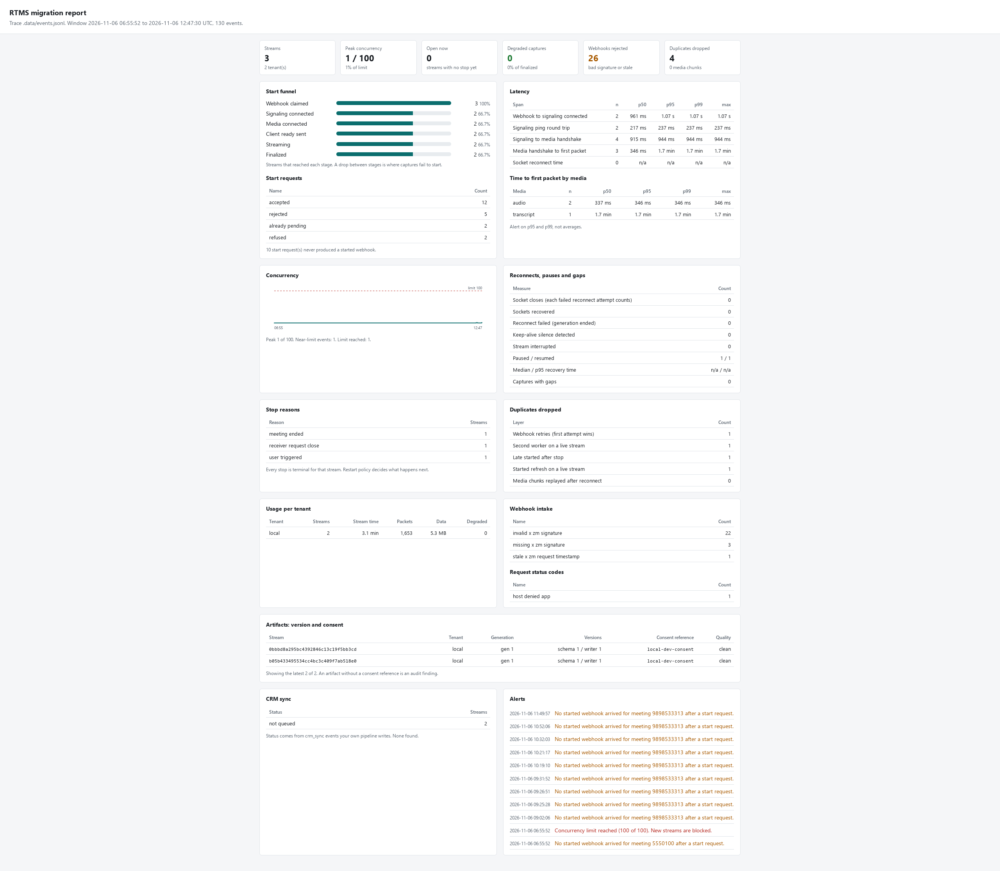
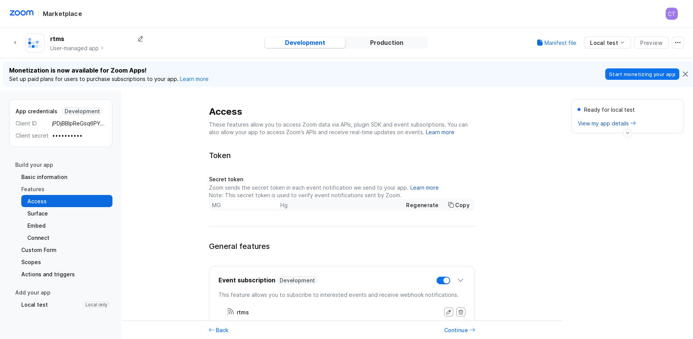
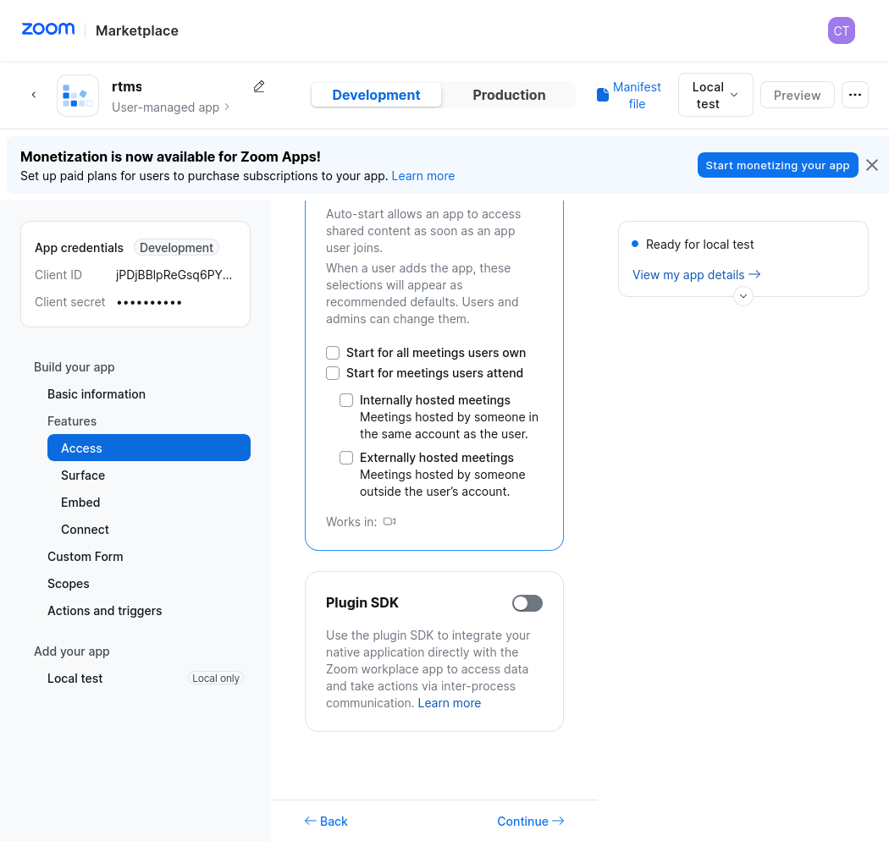

# 00 Backend design

Design documentation for a production RTMS backend: the architecture that survives real traffic, the media and codec choices you make before the first packet, the observability that tells you the truth, and the webhook edge that everything else depends on.

Read this before writing production code, not after the first outage.

**Contents**

- [01 Resilient architecture](#01-resilient-architecture) - the four-concern shape, stream ownership, reconnection, the shared store, capacity, failure drills
- [02 Media and codec planning](#02-media-and-codec-planning) - the decision table and the five choices to make explicitly
- [03 Observability](#03-observability) - the event log, metrics, alerting, tracing
- [04 Webhook resilience](#04-webhook-resilience) - the contract as an SLO, ingress, retries and duplicates, the operational checklist

Primary external sources, mirrored here with credit:

- Zoom's distributed reference implementation: <https://github.com/zoom/rtms-samples/tree/main/rtms-distributed-sample>
- Failover and reconnection: <https://developers.zoom.us/docs/rtms/meetings/failover-reconnection/>
- Media formats and handling: <https://developers.zoom.us/docs/rtms/meetings/media/>
- The single-instance reference in this repo: steps 5 and 6, and `60-stream-lifecycle-client` with `61-media-and-participants`

## 01 Resilient architecture

How a production RTMS backend is structured to scale horizontally, survive instance death, and reconnect the way Zoom's own reference implementations do.

Primary source: Zoom's [rtms-distributed-sample](https://github.com/zoom/rtms-samples/tree/main/rtms-distributed-sample), the official multi-node reference. This section states the architecture and the reasons behind each piece. The reference shows it as running code.

### The shape

A distributed RTMS backend separates four concerns that a single-process sample welds together:

```text
                    +---------------------+
 webhooks  -------> |  webhook ingress     |  stateless, N replicas, 200 in <3 s
                    |  (validate+enqueue)  |  behind a load balancer
                    +----------+----------+
                               | queue (per-stream ordering!)
                    +----------v----------+
                    |  stream workers      |  one stream = one worker at a time
                    |  signaling + media   |  leases, heartbeats, graceful handoff
                    +----------+----------+
                               |
          +--------------------+--------------------+
          |                  |                     |
   +------v-----+    +-------v------+    +---------v---------+
   | state store |   | artifact      |   | observability      |
   | leases,     |   | store         |   | metrics, traces,   |
   | dedupe,     |   | versioned,    |   | logs, stream clock |
   | seq windows |   | tenant-scoped |   |                    |
   +-------------+    +---------------+   +--------------------+
```

The single-instance path in this repo (`50-start-and-approval`, `60-stream-lifecycle-client`) is the same state machine on one node. Scale-out changes where the state lives, not what the states are.

### Stream ownership: one worker per stream

The cardinal rule of a distributed RTMS backend: **two live connections to one stream is a defect, not a feature** - the second kicks the first. Therefore:

- A stream is owned by exactly one worker at a time, enforced by a **lease** in the shared store (TTL, renewed by heartbeat).
- Webhook ingress never connects. It records the event and enqueues `stream_id -> event`.
- A worker claims a stream by taking the lease. The queue routes that stream's events to the lease holder.
- On worker death the lease expires and another worker claims the stream from the last durable state.

Ordering within a stream matters (sequence numbers, dedupe keys), so a partitioned queue keyed by `stream_id` - or a work queue with per-stream claiming - is required. A single shared FIFO that interleaves two streams' events is fine. A fan-out that duplicates them is not.

### The four reconnection scenarios

From Zoom's [Failover and reconnection](https://developers.zoom.us/docs/rtms/meetings/failover-reconnection/) - the state machine your worker implements, and the triggers that select each branch:

| # | Scenario | Trigger | Recover by |
|---|---|---|---|
| 1 | RTMS server failure | `meeting.rtms_started` arrives for an **already-active** stream | Tear down all sockets, reconnect everything to the (possibly new) `server_urls`. The `meeting_uuid` and `rtms_stream_id` are unchanged |
| 2 | Signaling dropped | `meeting.rtms_interrupted` webhook | Reconnect signaling **and** media, with exponential backoff. Server allows ~60 s before ending the stream |
| 3 | One media leg dropped | `MEDIA_CONNECTION_INTERRUPTED` signal on that socket | Reconnect **only** the affected media connection(s). The rest keep running |
| 4 | Stream terminated | `meeting.rtms_stopped` with `stop_reason` 10-19 or 24 | Full restart: a fresh `rtms_started` is required. Do not reconnect onto a dead stream |

**Backoff (scenarios 2 and 3):** start at 3 s, double per attempt, cap at 30 s. Reset the attempt counter to 0 after every successful handshake so failures do not compound. Never reconnect without the counter reset - a flapping socket then hammers the server at the base delay forever.

**The reconnect windows are budgets, not suggestions.** After an interruption you have ~60 s to restore signaling and then ~30 s for media. The 60-stream-lifecycle-client in this repo encodes them as `RTMS_SIGNALING_WINDOW_SEC` / `RTMS_MEDIA_WINDOW_SEC`. A distributed worker must treat them identically and escalate to a full restart (scenario 1 semantics) when a window is blown.

**Idempotent handshakes.** Reconnects reuse the same signed credentials from the original `rtms_started` payload - which is why the payload is the durable recovery record and is never rebuilt from the REST APIs.

### What the shared store must hold

Minimum durable state, all keyed by `stream_id`:

| Data | Why |
|---|---|
| The raw `rtms_started` payload | Recovery record: credentials, `server_urls`, operator, timestamps |
| Lease (owner, expiry) | Single-writer guarantee |
| Last sequence number per media socket | Gap and duplicate detection across reconnects |
| Dedupe keys (event+account+meeting+stream+ts) | Webhook retries, at-least-once queues, and double-delivery |
| Stream phase (`connecting/streaming/interrupted/finalized`) | Health, alerting, and safe worker handoff |
| Artifact manifest references | What was written, where, under which retention/consent |

Everything else (packets, transcripts) flows to the artifact store and never needs to survive a worker.

### Capacity and concurrency, revisited at scale

The single-layer numbers still bind: a concurrent stream is one RTMS **session ID** per media socket, the default account limit is 2,000 sessions, and `rtms.concurrency_near_limit` / `rtms.concurrency_limited` are your autoscaling signals. In a distributed deployment:

- Shed *before* the limit: admission control at ingress, not a pile-up of doomed workers.
- Place streams by worker capacity (sockets per worker is your unit. Each media socket is a real WebSocket with backpressure).
- Treat `concurrency_limited` as a capacity event to page on, and near-limit as the scale signal - the events arrive per account, so your ingress can reject early with a clean `started: false` instead of accepting and starving.

The dashboard a worker fleet feeds is the same panel set the 70-reporting-dashboard renders against real streams:



### Failure drills

A design is resilient only after these have been run against the real deployment:

1. Kill a worker mid-stream (lease expiry claim by a second worker. No duplicate sockets. Sequence continuity).
2. Drop signaling only (scenario 2 recovery inside the window. Media resumes. Sequence gap report clean).
3. Drop one media leg (scenario 3; other legs uninterrupted).
4. Simulate Zoom server failure (re-delivered `rtms_started` for a live stream. Scenario 1 full reconnect to new URLs).
5. Queue backlog while a worker is down, then recovery - no lost `stopped`, no phantom live stream.
6. The chaos harness: Zoom's [reconnection and chaos mode sample](https://github.com/zoom/rtms-samples/tree/main/rtms_api/reconnection_and_chaos_mode_js) exists precisely to test this machinery. Run it against your own implementation too.

### What not to build

- **A connection per meeting per service.** One owner, one connection set. Everyone else consumes artifacts or a fan-out of processed events.
- **Stateful ingress.** The moment your load balancer needs affinity for correctness, a deploy becomes an outage.
- **Reconnect-on-timer.** Every reconnect is trigger-driven (webhook or socket event) with backoff. Timers only arm watchdogs that *detect*, never ones that *retry*.
- **Silent lease steals.** A worker that loses its lease must close its sockets immediately. A grace period with two owners is the duplicate-connection defect with extra steps.

## 02 Media and codec planning

What you subscribe to in the media handshake decides your bandwidth, your CPU, your storage, and how hard muxing is - per stream, multiplied by every concurrent stream you committed to in 01. Choose deliberately. The defaults are a starting point, not a spec.

Primary source: Zoom's [Media handling](https://developers.zoom.us/docs/rtms/meetings/media/) reference. Formats below are as documented there. Re-verify at integration time, the page is versioned by Zoom's release train.

### The decision table

| Media | Wire format | Knobs (handshake) | The real cost drivers |
|---|---|---|---|
| Audio (mixed) | Raw PCM **L16**, 16 kHz, mono, base64 in JSON | `sample_rate`, `channel`, `send_rate` (20 ms steps, 20-1000 ms) | Storage math: L16 is uncompressed by design - compress after the meeting, not live |
| Audio (per-participant) | Same, one stream per user; merged audio is `user_id 0` | As above, plus the multi-stream subscription | N participants = N sockets of the same rate; concurrency and CPU multiply |
| Video (active speaker) | **H.264** above 5 fps; JPG/PNG frames at ≤ 5 fps | Resolution SD 480p/360p, HD 720p, FHD 1080p, QHD 2K; fps up to 30 | Resolution × fps is your bandwidth and decode budget. Resolution is dynamic - the server adapts to hardware/network, so plan for the ceiling you requested, receive whatever arrives |
| Video (single participant) | As above | The single-stream subscription API | One camera at a time per stream; subscription churn is its own load |
| Screen share | H.264 / image frames, same rules as video | As video | Bursty by nature: silent for minutes, then a slide storm. Size buffers for the burst |
| Transcript | JSON sentences | none (always on when scoped) | Cheap on the wire; the cost is the revision handling (see below) |

### The five decisions to make explicitly

**1. Which media, at all.** Every media type is its own socket, its own scope, its own concurrency unit. Audio + transcript is the cheap core that survives bad networks (notes, compliance, analytics). Add video only when a deliverable needs it - it is the expensive line in storage and decode, and its absence degrades nothing else.

**2. Audio: merged, per-participant, or both.** Merged (`user_id 0`) is one socket and enough for notes and volume analytics. Per-participant is the only way to diarize reliably, isolate speakers, or build per-user clips - and it multiplies sockets by headcount. Diarization from merged audio via active-speaker metadata is approximate. Per-participant is exact. Decide per product, not per deployment.

**3. Video: resolution and fps, honestly.** The handshake asks for a ceiling. Delivery adapts downward. 480p/15 fps is plenty for archival and thumbnails. 720p is the reviewable floor for humans. 1080p+ only for a stated product need, at multiples of the cost. Frame-based fallback (JPG ≤ 5 fps) exists for snapshot pipelines - do not build a video product on it.

**4. `send_rate` for audio.** 20 ms is the realtime-analysis default (lowest latency, highest packet rate: 50 packets/s). Raising it to 100-1000 ms cuts packet overhead for store-and-process pipelines at the price of latency and chunkier mute detection. Streaming ASR wants 20 ms. Batch transcription can tolerate 200-500 ms.

**5. Transcript revisions from day one.** The transcript stream carries corrections: the first delivery of a sentence is NEW (`attribute 1`), revisions are UPDATE (`attribute 2`) with the same `sentence_id` and full replacement text. A writer that only appends produces doubled text the first time Zoom corrects a word - this is the single most common transcript bug. The sample writer in this repo appends and does not handle revisions yet. Fix that before promising clean transcripts.

### Timestamps, gaps and muxing - the integration tax

- **The stream clock.** Every packet carries Zoom's server-side creation `timestamp`. It is the only join key across media. Store it everywhere. Never re-stamp from local clocks.
- **Buffered audio offset.** On `rtms_started` the server buffers audio (up to 60 s) while signaling connects. Video does not buffer. `buffer_duration = first_packet_ts - rtms_started_ts`. Subtract it when muxing or A/V drifts by exactly the connect time.
- **Silence is absence.** Muted users send no audio packets. Video stops when no video exists. Insert silence/filler frames by timestamp arithmetic, or your timelines have holes that every downstream consumer discovers independently.
- **Muxing is your job.** RTMS hands you separate per-media streams. ffmpeg/gstreamer with the timestamp discipline above combines them. Zoom's recording samples are the reference.

### Capacity arithmetic, per decision

Per stream, rough ordering-of-magnitude (verify with your own traffic):

| Choice | Wire in | Stored/h (raw) | Decode CPU |
|---|---|---|---|
| Audio merged 20 ms L16 | ~50 pkts/s | 16 kHz mono 16-bit = 32 kB/s ≈ 115 MB/h | Trivial |
| + per-participant audio (N people) | ×N sockets | ×N | ×N (still small) |
| Video 480p15 H.264 | ~300-800 kb/s | 0.15-0.4 GB/h | Moderate; ×1 decoder |
| Video 720p30 H.264 | ~1-2.5 Mb/s | 0.5-1.1 GB/h | The step where CPU per worker starts to matter |
| Transcript | Negligible | KBs | Negligible; the cost is revision logic |

Consequences for the capacity model above: each media type you add is another concurrency unit and another socket of backpressure on the worker. The `send_rate`, fps and resolution you pick are the numbers in your autoscaling policy - write them down next to the worker capacity, and re-derive the worker count whenever a default changes.

### What to subscribe to, by product shape

| Product | Subscribe | Skip at first | Add later when |
|---|---|---|---|
| Meeting notes / summary | Audio merged + transcript | video, per-participant | speaker clips are requested |
| Compliance capture | Audio merged + transcript (+ video if policy demands frames) | per-participant | policy names individuals |
| Live analytics dashboard | Transcript + active-speaker events | everything else | the dashboard shows video |
| Recording replacement | Audio + video + screen share, muxed from day one | - | - |
| Translation | Audio 20 ms + transcript | video | latency budget proves room |

Revisit this table when Zoom ships the announced multi-camera and Zoom Phone media types. Each new media type re-opens the handshake, the capacity math and the branch logic.

## 03 Observability

What to log and alert on, so an incident is a diagnosis and not an archaeology project. The 50-start-and-approval service already writes the event log this section generalizes (`.data/events.jsonl`, one JSON line per decision). A production backend keeps the same discipline at infrastructure grade.

### The event log is the product's flight recorder

One structured JSON line per *decision and transition*, not per packet:

- lifecycle: `start_attempt` (with the audit snapshot), `webhook_received/rejected` (with the reason), `watchdog_fired` (with the unmatched-request audit order), `request_status` (raw payload, even for known codes), `stream_phase` transitions, `stream_finalized`, `stream_stopped` (with stop reason)
- media: per-socket `connected/reconnect/backoff` with attempt counters, sequence gaps, duplicates dropped (by layer), first-packet latency, buffered-audio offset at start
- application: artifact writes with version and consent reference, tenant gate decisions, reauthorization and token refresh outcomes, deauthorization events

Rules that keep the log trustworthy:

1. **The stream clock on every line.** Zoom's event/packet timestamps next to your receive time - the pair is how you prove where a delay happened.
2. **Persist rejects and known-code statuses verbatim.** The payload you did not act on is the one the incident needs.
3. **One line, whole decision.** The audit snapshot (tenant, policy, consent, gate verdict) rides on the attempt line. Nobody reconstructs a decision from five lines.
4. **Log keys, not secrets.** Stream IDs, account IDs, meeting IDs: yes. Tokens, signatures: no.

### Metrics that map to page-worthy states

| Metric | Why it pages someone |
|---|---|
| Start success rate (started webhooks / accepted starts) | The funnel top; drops when Zoom-side or policy drifts |
| Time to first packet (distribution, worst cases) | Media-path health; a tail move precedes the outage |
| Signaling reconnect rate & outcome within the 60 s window | Scenario 2 recoveries failing = streams dying |
| Per-media-leg reconnects | Scenario 3; a leg-specific problem, not a stream problem |
| Sequence gaps & duplicates per socket | Transport quality and your dedupe correctness |
| Concurrency: near-limit event rate, limited events, per-tenant usage | Capacity events in [01](#01-resilient-architecture). Near-limit is the scale signal, limited pages |
| Watchdog firings with unmatched audit order | Lifecycle webhooks not arriving - the silent killer this repo's watchdog exists for |
| Webhook 5xx/latency at the edge | Retries and duplicate sessions start here |
| Reauthorization failure rate | Token decay; silent stream-loss for that user days later |
| Artifact writes failing / consent-missing artifacts | Compliance exposure and lost evidence |

### Alerting shape

- **Symptom alerts page. Cause alerts ticket.** `concurrency_limited`, watchdog firing, success-rate drop: page. Near-limit, reconnect churn, elevated 429s: ticket with a runbook link.
- **Alert on the worst cases, not averages** - the p-words are implementation details. What pages is "users hit multi-second media stalls".
- **Every alert links the stream's log slice** (`stream_id` + window). The on-call's first command should never be a grep.
- **Dashboards mirror the lifecycle**, top to bottom: ingress 200-rate and latency, queue depth and age, worker lease health, per-phase stream counts, per-socket media health, artifact and consent writes. The repo's 70-reporting-dashboard is the single-instance sketch of exactly these panels. Rebuild it on your metrics stack for production.

### Tracing

Propagate one trace per stream lifecycle: webhook receipt → claim → signaling handshake → each media handshake → artifacts → stop. Spans at worker handoff make the lease story visible. A stream that changes workers mid-incidents otherwise looks like two half-streams.

## 04 Webhook resilience

The webhook endpoint is the only door Zoom knows about. Everything above assumes deliveries arrive once, in order, and fast. They do not.

The 50-start-and-approval service already implements this edge. Its green states are the reference renders:





### The contract, restated as an SLO

- **200 within 3 seconds, always.** Validate the signature, enqueue, return. The 3 s ceiling is this repo's budget for the acknowledge. Zoom's guidance is to respond immediately, because a slow reply reads as failure and triggers a retry - and the retry is a second `rtms_started` that can open a duplicate signaling session and kick the first.
- **Every delivery verified.** `x-zm-signature` HMAC over the raw body, timestamp tolerance enforced, `x-zm-request-id` logged. URL validation (`endpoint.url_validation`) answers `{plainToken, encryptedToken}` from the same secret, computed over the plain token only.
- **At-least-once, so dedupe is not optional.** The natural key is event + account + meeting/session + `rtms_stream_id` + `event_ts`, with the delivery ID logged beside it. Keep keys ≥ 65 minutes. First delivery wins. Later ones get a 200 and nothing else.

### Ingress architecture

- **Stateless replicas behind a load balancer.** No session affinity: any replica can answer any delivery because the shared store (dedupe, leases, stream state) holds the truth. Sticky sessions turn a deploy into dropped deliveries.
- **Validate and enqueue in the request path. Nothing else.** No token refresh, no REST calls, no artifact writes inside the 3 s window - those belong to the stream workers via the queue.
- **Backpressure at the door.** If the queue is saturated or the account is `concurrency_limited`, still return 200 for lifecycle events you must not lose, and shed or defer the work - a 500 invites a retry storm on top of the incident. For `rtms_started` specifically, prefer accepting and letting the worker's watchdog/gate decide over bouncing the delivery.
- **Graceful degradation, ordered.** Replica loss: load balancer spreads, queue absorbs. Store outage: fail the enqueue honestly (retry will come) rather than acknowledge-and-lose. Never acknowledge a delivery you have not durably recorded.

### Retry and duplicate mechanics

- Zoom retries on non-200 and on timeout. Your dedupe key makes every retry idempotent. The 65-minute window covers the retry horizon. The rare slow-start case is why the window is generous, not the norm - a started webhook is usable for ~60 s, so retries usually arrive after the stream is live.
- Duplicate `rtms_started` for a live stream is also **scenario 1 (server failover)**: same key, but the payload carries new `server_urls` and means reconnect, not a retry. The dedupe layer forwards it. The stream worker decides retry-vs-failover from its own state. A naive "duplicate, drop" at ingress deletes failover signals.
- Reconcile missed deliveries with the watchdog: an accepted start with no webhook inside the window is an incident signal (audit order attached), not a queue to poll.

### Operational checklist

1. Load-test the edge at your peak concurrency × retry storms (a Zoom-side incident retries every stream at once).
2. TLS 1.2+ end to end, certificate monitoring, and the domain verification records in place before the first production webhook (see step 3).
3. Alert on 5xx rate, p-95 acknowledge latency against the 3 s budget, dedupe window size, and queue age.
4. Chaos: kill replicas mid-delivery, partition the store, slow the queue - the endpoint must keep answering 200 or fail loudly, never hang.
5. Rehearse the purge and deauthorization flows: they arrive as webhooks too, and they carry data-deletion obligations.
