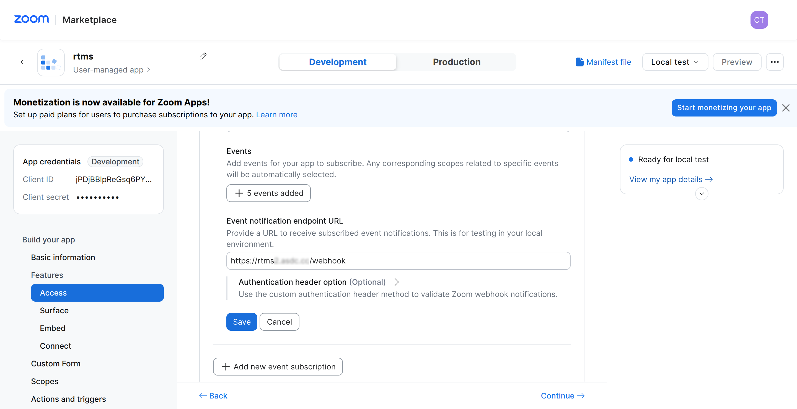
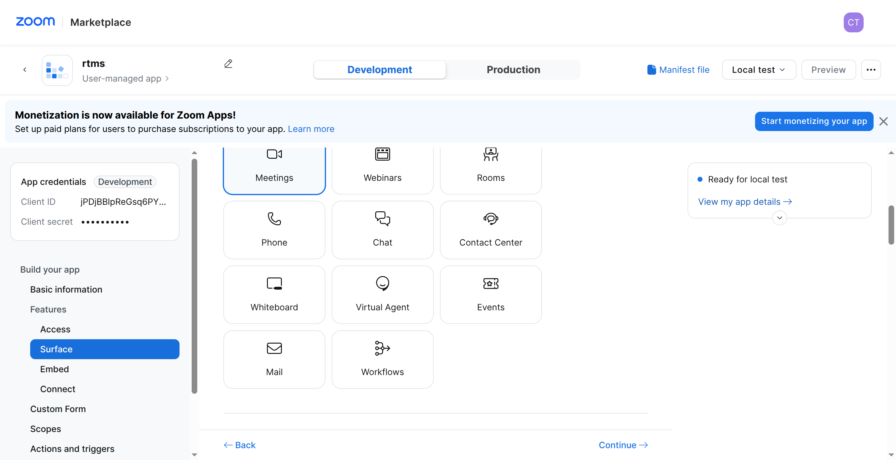
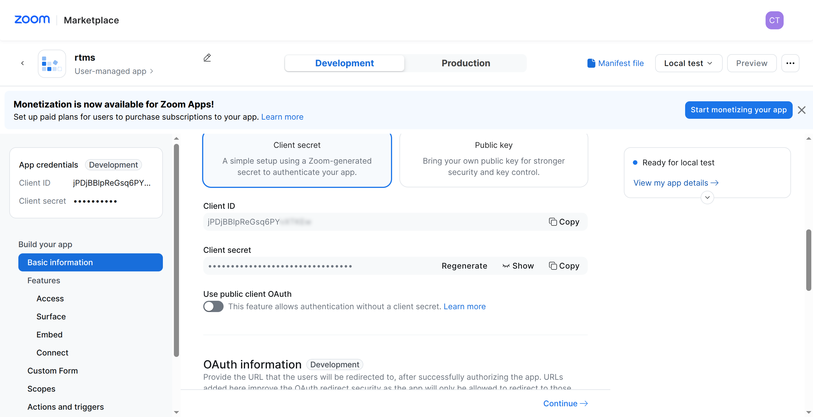

# 20 Configure the Marketplace app

Step 2 of 7. There is no code here. This step is Marketplace settings. The full instructions are in the root readme, section **Step 2**. In short, do the following.

1. Create the app and fill in the manifest, display and developer information.
2. Add the RTMS scopes, one per media type you capture, for example `meeting:read:meeting_audio` and `meeting:read:meeting_transcript`.
3. Subscribe to the lifecycle events `meeting.rtms_started`, `rtms_stopped`, `rtms_interrupted` and `rtms.request_status`.
4. Note the client ID and secret. They only sign the handshake. Installation, policy and approval do the authorizing.

**Contents**

- [Resources created](#resources-created) - the app type, why user-managed, granular scopes
- [The manifest](#the-manifest) and [manifest contents](#manifest-contents) - every field RTMS needs, field by field
- [An app that already has users](#an-app-that-already-has-users) - reauthorization and what changes for existing installs
- [Two ways to put it into Marketplace](#two-ways-to-put-it-into-marketplace) - the UI or the Marketplace API
- [Common questions](#common-questions) and [Adapting this sample](#adapting-this-sample)

---

# Guide part two: the Marketplace app

## Step 2. Configure the Marketplace app

Most of the work in this step is configuration. It covers `manifest.json`, scopes, event subscriptions and URLs.

### Resources created

A **General App** in the Zoom Marketplace (Develop, Build App, General App). Three constraints shape the rest of this step.

- RTMS events and scopes require a **user-managed** app (`USER_OPERATION`), installed by the person whose meetings it receives or added by an admin for users and groups. An admin-managed app (`ADMIN_MANAGEMENT`) cannot use the RTMS scopes, so a bot vendor running one needs a separate user-managed app for RTMS.
- RTMS scopes must be granular (new apps have them, an older app may need them turned on) and cannot be marked optional, so request only the media you use.
- Event subscription changes take 1-2 minutes to take effect.

A Meeting SDK bot did not need the pieces below. RTMS does.

| Piece | Why |
|---|---|
| Event subscription | The webhooks are the trigger. No `meeting.rtms_started` subscription means no stream |
| One media scope per media type | RTMS carries five media types (audio, video, screen share, chat and transcript), each gated by its own scope. The signaling handshake returns one media URL per type, and it only lists the types your app's scopes cover. Skip the chat scope, for example, and the response has no chat URL, so there is no chat socket to open and no chat to subscribe to |
| A public HTTPS webhook URL | Zoom calls it, and it must verify the signature and answer fast |
| Client ID, Client Secret, webhook Secret Token | The secret token verifies webhooks. The client secret signs the handshakes with Zoom's RTMS servers |

### The manifest

Marketplace keeps your app's settings as a `manifest.json`. You can fill in the same fields in the UI, or export the manifest, edit it and upload it again (see below). This is a minimal one for an app that receives audio and transcript from meetings and starts automatically:

```json
{
  "display_information": {
    "display_name": "Acme Meeting Notes",
    "description": "Capture live transcripts and audio from your Zoom meetings and turn them into notes."
  },
  "oauth_information": {
    "usage": "USER_OPERATION",
    "development_redirect_uri": "https://dev.acme.example.com/oauth/callback",
    "production_redirect_uri": "https://app.acme.example.com/oauth/callback",
    "oauth_allow_list": ["https://dev.acme.example.com", "https://app.acme.example.com"],
    "scopes": [
      { "scope": "meeting:read:meeting_audio", "optional": false },
      { "scope": "meeting:read:meeting_transcript", "optional": false }
    ],
    "scope_description": "Receive live audio and transcript through RTMS for the meetings the authorizing user attends or owns."
  },
  "features": {
    "products": ["ZOOM_MEETING"],
    "event_subscription": {
      "enable": true,
      "events": [
        {
          "subscription_name": "RTMS Lifecycle Events",
          "event_types": [
            "meeting.rtms_started",
            "meeting.rtms_stopped",
            "meeting.rtms_interrupted",
            "rtms.request_status",
            "rtms.concurrency_near_limit",
            "rtms.concurrency_limited"
          ],
          "development_webhook_url": "https://dev.acme.example.com/webhook",
          "production_webhook_url": "https://app.acme.example.com/webhook"
        }
      ]
    }
  },
  "developer_information": {
    "company_name": "Acme Inc.",
    "contact_name": "Jane Developer",
    "contact_email": "dev@acme.example.com"
  }
}
```

Replace the `example.com` placeholders with domains you control. Add one scope per media you receive and the events you need, from the lists below. For webinars, add the webinar product, scopes and events too.

### Manifest contents

**Scopes.**

| You want | Scope |
|---|---|
| Meeting audio, video, transcript, chat | `meeting:read:meeting_audio`, `meeting:read:meeting_video`, `meeting:read:meeting_transcript`, `meeting:read:meeting_chat` |
| Webinar audio, video, transcript, chat | `webinar:read:webinar_audio`, `webinar:read:webinar_video`, `webinar:read:webinar_transcript`, `webinar:read:webinar_chat` |
| Start and stop RTMS by REST | `meeting:update:participant_rtms_app_status` |
| An app that runs inside the meeting | `zoomapp:inmeeting`, plus the Zoom Apps JS APIs `startRTMS`, `stopRTMS`, `pauseRTMS`, `resumeRTMS`, `getRTMSStatus`, `onRTMSStatusChange`, with `appssdk.zoom.us` on the domain allow list and home URIs set |

No scope name for screen share is documented in this repo. Add it by hand in the Marketplace UI (Scopes, Add Scopes, search "RTMS") instead of guessing.

**Events.** Subscribe to `meeting.rtms_started`, `meeting.rtms_stopped`, `meeting.rtms_interrupted`, the same three for `webinar` if you use it, the Video SDK or Contact Center equivalents if those products are in scope, and `rtms.request_status`, `rtms.concurrency_near_limit`, `rtms.concurrency_limited`. Do not skip `rtms.request_status`: it is often the only explanation for a started webhook that never arrives.

**Webhook endpoint rules.** HTTPS. Verify `x-zm-signature` against the raw request body. Reject stale timestamps. Answer Zoom's `endpoint.url_validation` challenge. Return 200 before doing any work.

**Credentials.** Environment variables or a secret manager. Never the manifest, the repo or a screenshot.








### An app that already has users

Adding RTMS to an app that people already installed has three consequences, as follows.

1. **Users MUST authorize again.** When you update scopes or webhook settings, Zoom requires each user to authorize again before it issues a new code. There is no silent upgrade.

   Plan a reauthorization campaign. An in-product prompt, an email and admin outreach, with completion tracked per tenant. Zoom does not document whether existing users are notified, so send your own notice. After you change OAuth or webhook settings, regenerate the authorization URL instead of reusing old links (Zoom support guidance).
2. **Tokens.** Access tokens last one hour. Refresh tokens last 90 days and rotate, so always store the newest one. If a refresh is rejected, or the token lacks a new scope, only a new authorization fixes it. The start-and-approval sample does this bookkeeping per user.
3. **Many users.** An admin can add the app for users and groups (Marketplace, Manage, Apps on account, Users & Groups). The RTMS docs list no API of who authorized, or webhook for users added to a group later. So reconcile against your customer's group list on a schedule and show "authorized N of M seats" in your admin screen.

   Choose who your event subscription covers (all users in the account, the account and its subaccounts, or only users who added the app) and pick the narrowest that fits.

When a user removes a production app, Zoom posts a deauthorization event to the URL you set on the app. Verify it like a webhook, delete their tokens, and delete the rest of their data too.

### Two ways to put it into Marketplace

- **The UI at marketplace.zoom.us.** Under Features, Access, enable Event Subscription, add the events, and set the development and production webhook URLs. Under Scopes, choose Add Scopes and search "RTMS". Under Surface (only for in-meeting start), pick Meetings and Webinars, enable the Zoom App SDK and add the JS APIs.
- **The Marketplace API.** Validate (`POST /marketplace/apps/manifest/validate`), create (`POST /marketplace/apps`, which also needs top-level `company_name`, `contact_name` and `contact_email`), export (`GET /marketplace/apps/{appId}/manifest`) and replace (`PUT /marketplace/apps/{appId}/manifest`). Use a user or admin OAuth token with the Marketplace app-management scopes, and confirm the current base URL and scopes in Zoom's API reference. A validate call can return HTTP 200 for an invalid manifest, so read its `ok` and `errors`. A successful `PUT` is not proof of a valid manifest, so export it and read the exported manifest back.

### Common questions

**What goes wrong in a manifest?**

- a media you receive with no scope
- a scope you request but do not use (reviewers ask for a test step per scope)
- REST start without its scope
- an admin scope in a user-managed app
- missing started or stopped events
- no `rtms.request_status` when REST or a Zoom App can start a stream
- a webhook URL that is not HTTPS, is localhost, a private address, a tunnel or a default CDN host in production
- development equal to production, placeholder domains
- Zoom Apps settings that are incomplete, or secrets in the manifest

**Marketplace validation rejects the RTMS event names. Now what?** This has been seen with exported manifests that already contain them. Add the events in the UI (Features, Access, Add Events, search "rtms"), export the manifest, and check that the events are in it.

**Do I need a Zoom App?** Only if users need a panel inside the meeting or want to start RTMS from it. A server-side app that starts automatically or by REST does not.

**Can I test before anything is reviewed?** Yes. Use the development URLs on your own account. Development URLs may be a tunnel. Production URLs may not.

---
## Adapting this sample

Everything in this step is your product's configuration. Keep a copy of the final manifest in this folder as `manifest.json` when you have it, so the app config is versioned with the code it configures, and add screenshots of the finished Marketplace pages to `docs/` as you go.

---

## Elsewhere in the guide

All nine parts link below. Start from the [overview](../readme.md).

- [00 Design](../00-design/readme.md) - Production architecture. Failure drills, media choices, observability, the webhook SLO
- [10 Integration Advisor](../10-integration-advisor/readme.md) - Step 1. What changes, which sample to start from, the gap-checker
- [30 Publish](../30-publish/readme.md) - Step 3. Review, evidence and the rejections to avoid
- [40 Prepare](../40-prepare/readme.md) - Step 4. Admin enablement, host approval, consent, the status codes
- [50 Start And Approval](../50-start-and-approval/readme.md) - Step 5. The webhook endpoint, deduplication, claims, the tenant gate, OAuth
- [60 Stream Lifecycle Client](../60-stream-lifecycle-client/readme.md) - Step 6. Signaling and media sockets, keep-alives, reconnect, generations
- [61 Media And Participants](../61-media-and-participants/readme.md) - Step 6. The participant registry, the camera selector, media profiles
- [70 Reporting Dashboard](../70-reporting-dashboard/readme.md) - Step 7. The dashboard, alerts, the event contract, the production checklist
- [The root readme](../readme.md) - the seven steps, the plan and licensing checks, the reuse table

