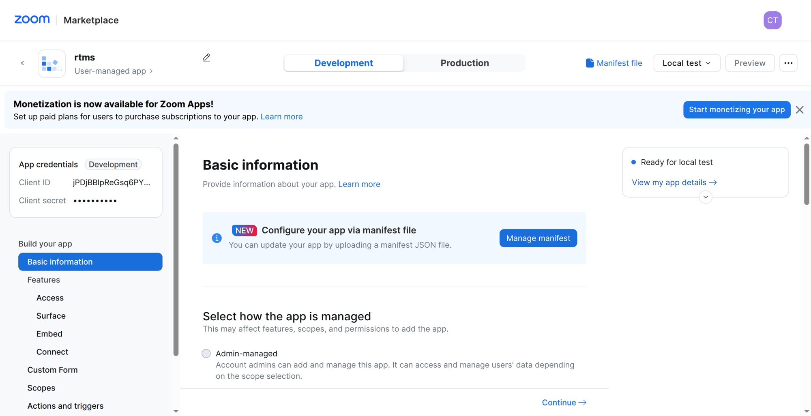
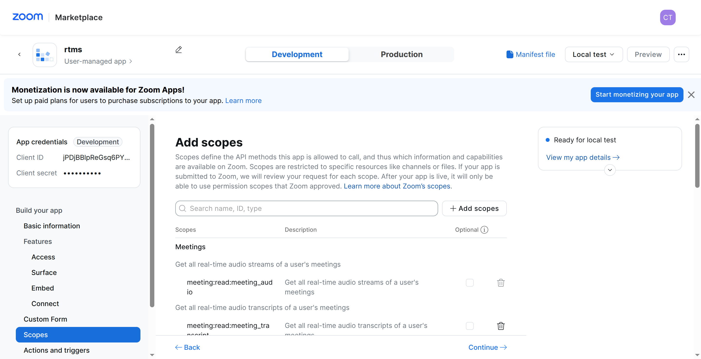

# 20 Configure the Marketplace app (Step 2)

There is no code in this folder. Step 2 configures your Zoom Marketplace app: `manifest.json`, granular media scopes, lifecycle event subscriptions, webhook URLs, and credentials.

**Contents**

- [App type and required pieces](#app-type-and-required-pieces)
- [Minimal manifest](#minimal-manifest)
- [Scopes, events, and endpoint rules](#scopes-events-and-endpoint-rules)
- [Upgrading an existing app with users](#upgrading-an-existing-app-with-users)
- [Applying changes in Marketplace](#applying-changes-in-marketplace)
- [Common questions](#common-questions)
- [Adapting this sample](#adapting-this-sample)

## App type and required pieces

Create a **General App** in Zoom Marketplace (Develop > Build App > General App). Three rules shape the configuration:

- **User-managed only (`USER_OPERATION`).** RTMS scopes and events require a user-managed app installed by the user or added by an admin for users and groups. An admin-managed app (`ADMIN_MANAGEMENT`) cannot request RTMS scopes, so teams running an admin-managed bot need a separate user-managed app for RTMS.
- **Granular, required scopes.** RTMS scopes must be granular (older apps may need granular scopes enabled) and cannot be optional. Request only the media types you use.
- **Propagation delay.** Event subscription edits take 1-2 minutes to take effect.

Pieces required for RTMS that a Meeting SDK bot did not need:

| Piece | Why it is required |
|---|---|
| Event subscription | Webhooks trigger every stream. Without `meeting.rtms_started`, no stream starts |
| One scope per media type | Each media type (audio, video, screen share, chat, transcript) has its own scope. The signaling handshake returns media URLs only for types your app's scopes cover |
| Public HTTPS webhook URL | Zoom posts lifecycle events here; it must verify signatures and answer within 3 seconds |
| Client ID, Client Secret, Secret Token | Secret Token verifies webhooks; Client Secret signs WebSocket handshakes with Zoom's RTMS servers |

## Minimal manifest

Marketplace stores app settings as `manifest.json`. Fill these fields in the UI or edit and upload the manifest directly. Below is a minimal manifest for an app capturing meeting audio and transcript:

```json
{
  "display_information": {
    "display_name": "Acme Meeting Notes",
    "description": "Capture live transcripts and audio from your Zoom meetings and turn them into notes."
  },
  "oauth_information": {
    "usage": "USER_OPERATION",
    "development_redirect_uri": "https://dev.acme.example.com/oauth/callback",
    "production_redirect_uri": "https://app.acme.example.com/oauth/callback",
    "oauth_allow_list": ["https://dev.acme.example.com", "https://app.acme.example.com"],
    "scopes": [
      { "scope": "meeting:read:meeting_audio", "optional": false },
      { "scope": "meeting:read:meeting_transcript", "optional": false }
    ],
    "scope_description": "Receive live audio and transcript through RTMS for the meetings the authorizing user attends or owns."
  },
  "features": {
    "products": ["ZOOM_MEETING"],
    "event_subscription": {
      "enable": true,
      "events": [
        {
          "subscription_name": "RTMS Lifecycle Events",
          "event_types": [
            "meeting.rtms_started",
            "meeting.rtms_stopped",
            "meeting.rtms_interrupted",
            "rtms.request_status",
            "rtms.concurrency_near_limit",
            "rtms.concurrency_limited"
          ],
          "development_webhook_url": "https://dev.acme.example.com/webhook",
          "production_webhook_url": "https://app.acme.example.com/webhook"
        }
      ]
    }
  },
  "developer_information": {
    "company_name": "Acme Inc.",
    "contact_name": "Jane Developer",
    "contact_email": "dev@acme.example.com"
  }
}
```

Replace `example.com` with domains you control. Add webinar products, scopes, and events if you also support webinars.

## Scopes, events, and endpoint rules

### Scopes

| Capability | Scope |
|---|---|
| Meeting audio, video, transcript, chat | `meeting:read:meeting_audio`, `meeting:read:meeting_video`, `meeting:read:meeting_transcript`, `meeting:read:meeting_chat` |
| Webinar audio, video, transcript, chat | `webinar:read:webinar_audio`, `webinar:read:webinar_video`, `webinar:read:webinar_transcript`, `webinar:read:webinar_chat` |
| REST start, stop, pause, resume | `meeting:update:participant_rtms_app_status` |
| In-meeting Zoom App panel | `zoomapp:inmeeting`, plus Zoom Apps JS APIs `startRTMS`, `stopRTMS`, `pauseRTMS`, `resumeRTMS`, `getRTMSStatus`, `onRTMSStatusChange`, with `appssdk.zoom.us` on the domain allow list and home URIs set |

No screen-share scope string is pinned in this repo. Add it in the Marketplace UI (Scopes > Add Scopes > search "RTMS") rather than guessing the string.

### Events

Subscribe to `meeting.rtms_started`, `meeting.rtms_stopped`, `meeting.rtms_interrupted`, plus `rtms.request_status`, `rtms.concurrency_near_limit`, and `rtms.concurrency_limited`. Add the `webinar.*`, `session.*` (Video SDK), `phone.call_rtms_*`, or `contact_center.voice_rtms_*` equivalents if those products are in scope. Keep `rtms.request_status` enabled: it is often the only signal explaining why a started webhook never arrived.

### Webhook and credential rules

- Serve webhooks over HTTPS (TLS 1.2+). Verify `x-zm-signature` against raw request bytes, reject stale timestamps, answer `endpoint.url_validation`, and return HTTP 200 before doing downstream work.
- Store Client Secret and Secret Token in environment variables or a secret manager, never in `manifest.json`, git, or screenshots.






## Upgrading an existing app with users

Adding RTMS to an app that already has installs requires three operational steps:

1. **Users must reauthorize.** Updating scopes or webhook settings does not silently upgrade existing installs. Plan a reauthorization campaign (in-product banner, email, admin outreach) and track completion per tenant. After changing OAuth or webhook settings, regenerate the authorization URL instead of reusing old links.
2. **Track rotating tokens per user.** Access tokens expire in one hour; refresh tokens expire in 90 days and rotate on every refresh, so always store the newest refresh token. If a refresh is rejected or lacks a new scope, only reauthorization fixes it. `50-start-and-approval/src/oauth.js` handles this per-user lifecycle.
3. **Reconcile group installs.** Admins can add an app for users and groups (Marketplace > Manage > Apps on account > Users & Groups), but Zoom exposes no API listing who has authorized and no webhook when users join a group later. Reconcile against your customer's user list on a schedule and display authorization coverage in your admin screen. Choose the narrowest event-subscription scope that fits (users who added the app, account, or account plus sub-accounts).

Configure the app's **deauthorization URL** (`POST /oauth/deauthorize` in step 5). When a user removes a production app, verify the signed notification, delete their tokens, and purge their remaining stored data.

## Applying changes in Marketplace

- **Marketplace UI (`marketplace.zoom.us`):** enable Event Subscription under Features > Access, add events, and save both development and production webhook URLs. Add scopes under Scopes > Add Scopes (search "RTMS"). Enable Meetings/Webinars under Surface (required even when not building an in-meeting panel; add the Zoom App SDK and JS APIs if you do build one).
- **Marketplace API:** validate (`POST /marketplace/apps/manifest/validate`), create (`POST /marketplace/apps`, which also requires top-level `company_name`, `contact_name`, `contact_email`), export (`GET /marketplace/apps/{appId}/manifest`), and replace (`PUT /marketplace/apps/{appId}/manifest`). A validate call can return HTTP 200 for an invalid manifest, so inspect `ok` and `errors`. After a `PUT`, export the manifest back to verify the saved state.

## Common questions

**What breaks a manifest during review or testing?**
Receiving media without its scope; requesting unused scopes (reviewers test every declared scope); calling REST start without `meeting:update:participant_rtms_app_status`; putting an admin scope in a user-managed app; omitting `rtms_started`, `rtms_stopped`, or `rtms.request_status`; using non-HTTPS, localhost, private IP, tunnel, or generated CDN URLs in production; setting development equal to production; leaving placeholder domains; incomplete Zoom App settings; or committing secrets.

**Marketplace validation rejects RTMS event names in my JSON manifest. What now?**
This happens even on exported manifests. Add the events through the UI (Features > Access > Add Events > search "rtms"), then export the manifest and verify the event list.

**Do I need a Zoom App?**
Only if users need an in-meeting UI panel or start/stop buttons inside the Zoom client. Server-side apps that start automatically or via REST do not need a Zoom App UI, though the Meetings surface checkbox must still be enabled.

**Can I test before Marketplace review?**
Yes. Use development URLs (tunnels are allowed in development, not production) on your own account.

## Adapting this sample

Save your exported `manifest.json` in this folder once configured so your Marketplace settings stay versioned alongside the code, and keep screenshots of your finished Marketplace pages in `docs/`.

---

## Elsewhere in the guide

Start from the [overview](../readme.md).

- [00 Design](../00-design/readme.md) - Production architecture, failover drills, media choices, observability, webhook SLO
- [10 Integration Advisor](../10-integration-advisor/readme.md) - Step 1: what changes, starter samples, gap checker
- [30 Publish](../30-publish/readme.md) - Step 3: review package, checks, common rejections
- [40 Prepare](../40-prepare/readme.md) - Step 4: admin enablement, host approval, consent, status codes
- [50 Start and Approval](../50-start-and-approval/readme.md) - Step 5: webhook intake, claims, tenant gate, OAuth
- [60 Stream Lifecycle Client](../60-stream-lifecycle-client/readme.md) - Step 6: signaling, media, keep-alives, reconnect, manifests
- [61 Media and Participants](../61-media-and-participants/readme.md) - Step 6: participant registry, camera selector, media profiles
- [70 Reporting Dashboard](../70-reporting-dashboard/readme.md) - Step 7: dashboard, alerts, event contract, rollout
