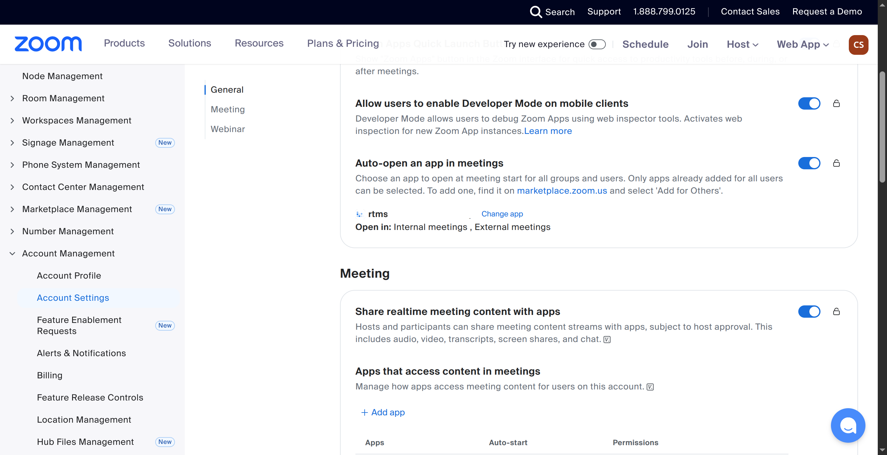
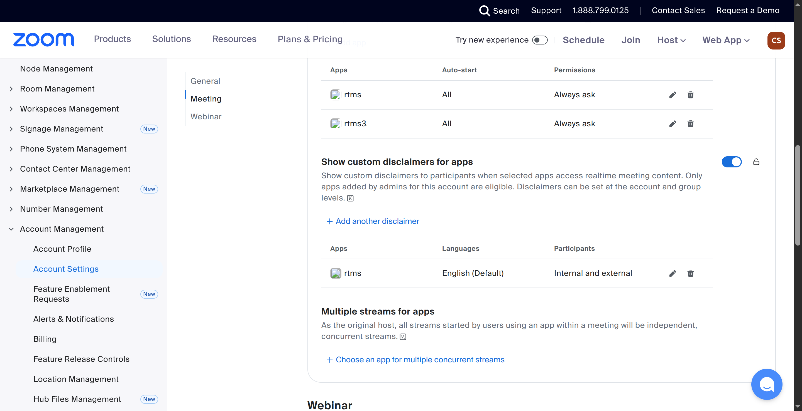

# 40 Prepare accounts and approvals (Step 4)

There is no code in this folder. Publishing the app does not start streams by itself: an account admin must enable RTMS and allow your app, and hosts may need to approve capture meeting by meeting. Because Meeting SDK bots skipped this layer, most "RTMS did not start" tickets trace back here.

To see how a service handles the status events described below, run `npm run demo:03` in [50-start-and-approval](../50-start-and-approval/readme.md).

**Contents**

- [Account admin settings](#account-admin-settings)
- [Host controls](#host-controls)
- [Four ways to start a stream](#four-ways-to-start-a-stream)
- [Externally hosted meetings](#externally-hosted-meetings)
- [Participant visibility and consent](#participant-visibility-and-consent)
- [Request status and REST outcome codes](#request-status-and-rest-outcome-codes)
- [Common questions](#common-questions)
- [Adapting this sample](#adapting-this-sample)

## Account admin settings

Before any stream can start for a customer account, their Zoom admin must configure three settings:

1. Sign in at `zoom.us` as an admin.
2. Open **Account Management > Account Settings > Zoom Apps** and enable RTMS for the account.
3. For your app, pick where it may auto-start: **Meetings users own**, **Meetings users attend, internally hosted**, and **Meetings users attend, externally hosted**.
4. Set participant permissions for meetings hosted by this account: **Always ask** prompts the host each time; **Always allow** skips the prompt. Configure internal and external participants separately.






The same controls exist at the group and user levels. Only an admin sets account-wide or group policy; individual users cannot grant account-wide auto-start.

### Who controls what

| Control | Set by | Scope |
|---|---|---|
| Auto-start categories (owned, internal attended, external attended) | App user, or admin for account, group, or user | That user's meetings per category |
| Always ask vs Always allow (internal and external) | Meeting host, or host's account admin | Participants' apps in meetings that host runs |
| Allow once, Deny, Always allow in my meetings | Host inside the meeting | That meeting, or all of that host's future meetings |

For meetings hosted inside your customer's own account, their admin can set **Always allow** for internal participants so capture starts without prompting or waiting for the host. For meetings hosted by another company, only that external host or their admin can grant **Always allow**.

Auto-start applies by category to every user in scope. Avoid turning it on account-wide during initial rollout, or you will capture meetings for teams that never bought your product:

- Roll out to specific user groups first.
- Match auto-start categories to your product (sales assistants want owned plus externally hosted; team notetakers want internally hosted; compliance tools want admin-deployed capture across all meetings).
- Set sensible default auto-start categories in your app's install configuration.
- For per-meeting filtering (such as "only calendar meetings"), use the Zoom App start button, REST start, or a capture filter in step 5.

## Host controls

Inside a meeting, hosts manage RTMS under **Host tools > Share realtime meeting content with apps** (or the webinar equivalent). Selecting **Always allow in my meetings** skips future prompts for that host, though the host can still stop or disable the app at any time.

| Account and host state | Outcome |
|---|---|
| RTMS on, app enabled, Always ask | Host receives an approval prompt. Approval starts the stream; denial sends `rtms.request_status` 1 or 3 |
| RTMS on, app enabled, Always allow | Stream starts without prompting. Host tools can still stop it |
| App not enabled by admin | Auto-start never fires regardless of Marketplace configuration |
| Host chose "Always allow in my meetings" | Future meetings by that host skip the prompt |

## Four ways to start a stream

| Start path | Initiated by | Requirements |
|---|---|---|
| Auto-start | Admin/user policy | Policy covers the meeting category; host approves if set to Always ask |
| Zoom Apps `startRTMS()` | App user in meeting | Meetings/Webinars surface and Zoom Apps JS APIs enabled; desktop client 6.5.5+ |
| REST `PATCH /live_meetings/{meetingId}/rtms_app/status` | Token user or explicit `participant_user_id` | User OAuth token with `meeting:update:participant_rtms_app_status`; target must be an invitee who has already joined |
| Host or alternative host | Meeting host | Host or alt-host is in the meeting; app-user policy still applies |

A resolved `startRTMS()` promise or an HTTP `204` from REST only means Zoom accepted the request. Wait for the `*_rtms_started` webhook before opening WebSockets.

`rtms.request_status` code `2` means the **app owner** is absent (distinct from the meeting host, though both may be required). Store the app user, token subject, explicit `participant_user_id`, and approving host in your audit log.

## Externally hosted meetings

Two independent policies apply and neither overrides the other. Your customer's admin must allow **Meetings users attend, externally hosted** for users bringing the app into outside meetings, and the external host still decides whether to approve capture. Nobody can pre-approve another company's host or bypass their prompt.

The user bringing the app in must have installed and authorized it, must appear on the **meeting invite list**, and (for REST start) must already be joined. Joining through an anonymous shared link fails with "Not allowed to start RTMS app". Treat invite-list membership as required for external meetings even outside REST start.

```text
App user joins an external meeting
  |-- attendee-side policy allows external meetings?  no  -> fix customer admin policy
  |-- host present?                                   no  -> cannot approve yet; wait
  |-- host response: Allow once                       -> this meeting starts
  |                  Always allow                     -> future requests skip prompt
  |                  Deny                             -> request_status 1 or 3; do not blind retry
  '-- host tools or app disabled?                     yes -> host must re-enable it
```

| Start path | External-meeting constraint |
|---|---|
| Auto-start | Customer admin enables external attended meetings; external host policy governs the prompt |
| Zoom Apps `startRTMS()` | App user is present and clicks Start; prompt goes to the external host if Always ask |
| REST status endpoint | Target must be an invited, joined participant; shared-link joins fail |
| Host or alt-host start | Enables meeting context, while app-user policy and invitee rules still apply |

If external host approval or invite-list rules break your product contract, keep a visible Meeting SDK bot as the fallback for those meetings.

## Participant visibility and consent

RTMS removes the participant tile, while Zoom still shows the app in the active-app indicator. Legal consent combines admin policy, host approval, your customer's recording/AI policy, and participant disclosures. Store policy and approval references alongside every artifact; never treat a live stream as implicit proof of consent.

## Request status and REST outcome codes

### `rtms.request_status` webhook codes

Persist the raw payload for every `rtms.request_status` event, including familiar codes. Alert on unknown codes and never treat them as success.

| Status | Meaning | Action |
|---|---|---|
| 1 | Request denied | Fix policy or approval; do not blind retry |
| 2 | App owner not present | Wait for the app owner to join or use another start path |
| 3 | Host denied the app | Ask the host to approve or choose Always allow |
| 4 | License expired or feature disabled | Renew or enable entitlement; no retry |
| 5 | No RTMS concurrency limit set | Configure the account/sub-account concurrency limit |
| 6 | RTMS server failed | Retry as a new stream with backoff |
| 7 | Server update scheduled | Record `reboot_in_minutes`, pause new starts, and drain |
| 8 | Server update canceled | Resume normal starts |

**Canceling a pending approval request.** The participant status endpoint only accepts `start`, `stop`, `pause`, or `resume`, and calling `stop` before a stream starts fails with `13277`. A pending request only clears when the host answers or Zoom expires it. Let your own watchdog retire the pending attempt and handle a late `rtms_started` if it arrives.

### REST start/control outcomes

| Code / HTTP | Meaning | Action |
|---|---|---|
| 204 | Request accepted | Wait for `*_rtms_started`; do not connect yet |
| 3000 or 4927 | Meeting has not started | Queue until live; do not retry immediately |
| 2310 | RTMS operation failed | Check account tier (Basic fails here), request state, and policy |
| 13277 | Action requires a started app | Stop, pause, and resume only work on an active stream |
| 2312 | Participant does not exist | Fix `participant_user_id` or omit it to use the token user |
| 2308 or 2309 | Caller role not allowed | Use a host, alt-host, or panelist path |
| 13273 | Meeting does not support RTMS | Check entitlement and app configuration |
| 13267 | RTMS app disabled | Enable "Share realtime meeting content with apps" |
| 13262 | App not authorized for content | Fix app allowlist and authorization |
| 404 | Meeting not found | Check meeting ID; double-encode UUIDs starting with `/` or containing `//` |
| 429 | Rate limited | Back off with jitter (handled by `retryingRestClient.js`) |

### In-meeting client messages

- `"Request sent to the host."` Pending; do not connect.
- `"Request for app to share content denied by host."` Maps to `request_status` 1 or 3; do not auto-retry.
- `"Host cannot approve your app's access to content."` Wait for host state to clear.
- `"Host disabled your app from sharing content."` Host must re-enable in Host tools.
- `"Request to share content cannot be sent until the host has joined."` Wait for host (maps to status 2).
- `"Apps sharing content have been disabled."` Host or admin must enable app sharing (maps to status 4).

## Common questions

**Can a calendar invite start RTMS on its own?**
No. Use the calendar to identify the expected app user and meeting, verify installation and policy, and then rely on auto-start, REST start once the invitee joins, or the Zoom App Start button.

**Nothing started. In what order should I check?**
Check in sequence: (1) app installed for the user, (2) attendee-side policy allows this meeting category, (3) user is on the invite list, (4) host is present, (5) host approved, (6) Host tools allow apps, (7) `rtms.request_status` events.

**What should I log on each start attempt?**
Meeting ID, target user, policy snapshot, tenant gate verdict, client ID, active scopes, approving host, `rtms.request_status`, and later stream events. For Zoom support tickets, also capture meeting UUID, `rtms_stream_id`, webhook `x-zm-request-id`, and REST response `x-zm-trackingid` (unlike Meeting SDK bots, which rely on encrypted SDK logs).

**Why did `rtms.request_status` never arrive after a denial?**
`rtms.request_status` fires only when all three hold: the user is an invited participant, the start used the participant REST API with that user's token, and `meeting:update:participant_rtms_app_status` was already granted when that token was issued. Check webhook reachability first, then reauthorize the user, then reinstall if webhook URLs or scopes changed.

**What if a host and participant (or two of our users) start the same RTMS app in one meeting?**
When a host and a participant belong to the **same Zoom account** and start the **same RTMS Marketplace app**, Zoom deduplicates the stream by design and sends only **one** `meeting.rtms_started` webhook. If the original host configured auto-start for the app, the original host's `user_id` (`operator_id`) is always in the webhook payload—even if a same-account participant also has auto-start enabled or starts the app. That is expected behavior, not a missing webhook. When multiple users *do* produce separate streams with distinct `operator_id`s (for example, users in different Zoom accounts or separate participant starts when the original host did not start the app), enforce a meeting-level policy in step 5: first start wins (`MEETING_POLICY=first_wins`, the default), owner/host wins, or keep both and pay for both.

**Is a REST start queued if the host has not joined yet?**
Treat this as unverified. Partners report that requests sent before the host joins are not retried automatically. Either configure **Always allow** on the host's account, or record `waiting_for_host`, arm a watchdog, and send one fresh request when you detect the host has joined. Never poll on a timer.

**How long does a pending host approval wait?**
Zoom publishes no expiration code for pending requests. Treat your watchdog interval as your own timeout: retire the attempt, notify the user, and handle or stop a late `rtms_started` if it arrives.

**How should we handle long meetings with rotating attendees (such as interview panels)?**
Put the app on the meeting scheduler with auto-start enabled for owned meetings. When the meeting owner leaves and transfers host, continuous meeting sharing keeps the owner's stream alive and lets your backend keep using the owner's token. If a non-owner app user leaves, the stream ends with stop reason `3`. If an external recruiter booked the meeting, fall back to an internal participant and accept that the stream ends when they leave, or ask the external scheduler to install the app.

**What about client version floors and start-without-host?**
In-meeting Zoom Apps start requires Zoom desktop client 6.5.5 or later. Capturing before the host joins requires the account admin setting **Allow meeting to start without host**.

**What about REST rate limits and server footprint?**
`PATCH .../rtms_app/status` shares standard Zoom REST rate limits; `50-start-and-approval/src/retryingRestClient.js` retries `429` responses with `Retry-After` or jittered backoff (do not wrap it in a second retry loop). Compared to bots, RTMS removes per-meeting client processes and raw-frame decode overhead, leaving lightweight socket state per connection.

## Adapting this sample

Store your customer rollout checklist in this folder: target accounts, pilot groups, approval policy choices, and screenshots matching your customer's admin UI.

---

## Elsewhere in the guide

Start from the [overview](../readme.md).

- [00 Design](../00-design/readme.md) - Production architecture, failover drills, media choices, observability, webhook SLO
- [10 Integration Advisor](../10-integration-advisor/readme.md) - Step 1: what changes, starter samples, gap checker
- [20 Configure](../20-configure/readme.md) - Step 2: Marketplace manifest, scopes, events, credentials
- [30 Publish](../30-publish/readme.md) - Step 3: review package, checks, common rejections
- [50 Start and Approval](../50-start-and-approval/readme.md) - Step 5: webhook intake, claims, tenant gate, OAuth
- [60 Stream Lifecycle Client](../60-stream-lifecycle-client/readme.md) - Step 6: signaling, media, keep-alives, reconnect, manifests
- [61 Media and Participants](../61-media-and-participants/readme.md) - Step 6: participant registry, camera selector, media profiles
- [70 Reporting Dashboard](../70-reporting-dashboard/readme.md) - Step 7: dashboard, alerts, event contract, rollout
