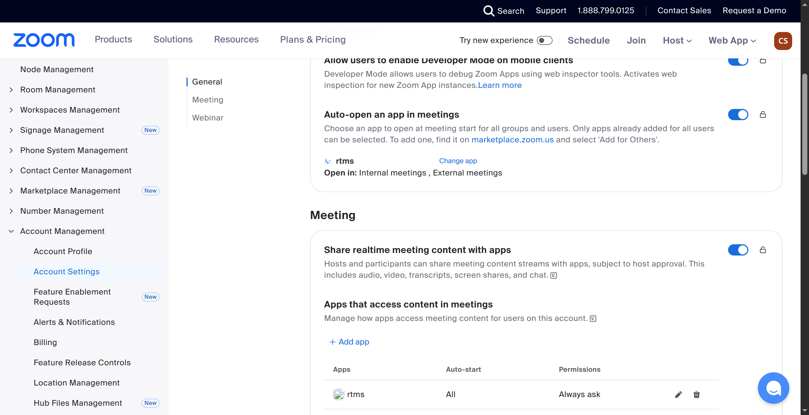

# 40 Prepare accounts and approvals

Step 4 of 7. There is no code here. This step is admin settings, host actions and people, and none of it can be simulated honestly. The full instructions are in the root readme, section **Step 4**. What has to be true before a stream can start:

- RTMS enabled for the account, the app installed, the user eligible.
- The admin policy allows the app, and where required the host approves, meeting by meeting.
- Auto-start, if you use it, is scoped to the right groups and meeting categories.

**Contents**

- [What the customer's account admin does](#what-the-customers-account-admin-does) and [what the host does](#what-the-host-does) - enablement and per-meeting approval
- [Four ways to start a stream](#four-ways-to-start-a-stream) - who decides, what must be true
- [Meetings hosted by another company](#meetings-hosted-by-another-company) - the two controls and neither replaces the other
- [What participants see, and who consents](#what-participants-see-and-who-consents) and [the status events](#read-the-status-events)
- [Common questions](#common-questions), [code for this step](#code-for-this-step), [Adapting this sample](#adapting-this-sample)

To see how a service reacts to the request-status events, run `npm run demo:03` (step 5's simulated demo).

---

# The guide, part four: accounts, approval and consent

## Step 4. Prepare each meeting

Publishing the app is not enough to start a stream. RTMS is off until an account admin enables it and allows your app, and a host may still approve each meeting. A bot needed none of this, so most "RTMS did not start" problems live here.

### What the customer's account admin does

1. Sign in at zoom.us as an admin.
2. Under Account Management, open Account Settings, then Zoom Apps, and enable RTMS for the account.
3. For your app, choose where it may start from **Meetings users own**, **Meetings users attend, internally hosted** and **Meetings users attend, externally hosted**.
4. Choose the participant permission for meetings that this account's users **host**. **Always ask** makes the host approve each time. **Always allow** skips the prompt. Set internal and external participants separately.




The same controls exist for groups and single users. Only an admin sets account, group or user policy. A user cannot grant account-wide auto start.

**Who sets what.** Two separate controls, set by different people:

| Control | Set by | Applies to |
|---|---|---|
| Where the app auto-starts: meetings the user owns, meetings attended that are internally hosted, meetings attended that are externally hosted | The app user, or an admin for the account, a group or a user | The user's meetings, per category |
| Always ask or Always allow, internal and external | The meeting owner: the host, or the host's account admin | Participants' apps in meetings that owner hosts |
| Allow once, Deny, Always allow in my meetings | The host, in the meeting | That meeting, or all the host's meetings |

Your customer's admin therefore decides where **your user's** app tries to start.

- For meetings hosted by that customer's own people, the admin can set Always allow for internal participants, and then the host does not even need to be in the meeting.
- For a meeting hosted by another company, only that host or that company's admin can make it Always allow.

Auto-start works by category, not by meeting, and it applies to every user in scope. One partner turned it on account-wide for a product only a sales team had bought, and captured meetings outside the intended group.

- Deploy to groups, never account-wide on the first pass.
- Match categories to the product. A sales assistant wants meetings I own plus externally hosted, a team notetaker wants internally hosted, a compliance tool wants admin-deployed for every meeting on the account.
- Set your app's default auto-start so the install flow suggests the right one.
- For a per-meeting decision, use the Zoom App button, REST start, or the capture filter in step 5.

### What the host does

In the meeting, Host tools, "Share realtime meeting content with apps" (or the webinar equivalent). When approving, the host can choose "Always allow in my meetings". Host tools can still stop or disable the app at any time.

| Setting | Result |
|---|---|
| RTMS on, app enabled, Always ask | The host sees a request. It starts when approved. A denial arrives as request status 1 or 3 |
| RTMS on, app enabled, Always allow | Starts without a prompt. Host tools can still stop it |
| App not enabled by the admin | No auto start, whatever the Marketplace configuration says |
| Host chose "Always allow in my meetings" | The prompt is skipped for that host's meetings |

### Four ways to start a stream

| Path | Who decides | What must be true |
|---|---|---|
| Auto start | The admin's policy for the app user | The app user is bound by policy. The host, if the policy is Always ask |
| Zoom Apps `startRTMS()` | The app user, from inside the meeting | The Zoom App surface and JS APIs are enabled, and policy permits |
| REST `PATCH /live_meetings/{meetingId}/rtms_app/status` | The token's user, or an explicit `participant_user_id` | OAuth token with `meeting:update:participant_rtms_app_status`. The participant is an **invitee and has already joined** |
| Host or alternative host | The meeting host | The host or alternative host is in the meeting. The app user's policy still applies |

A resolved `startRTMS()` promise or a REST `204` only means "request accepted". Wait for the started webhook, then connect.

Request status 2 means the **app owner** is not present. That is not the meeting host, and both can be required. For audit, store the app user, the token's user, any explicit participant and the approving host.

### Meetings hosted by another company

Two controls apply and neither replaces the other. **Your** admin must enable "Meetings users attend, externally hosted" for the people who will bring the app into other companies' meetings. **The external host** decides whether to approve it for their meeting. Your admin cannot approve for another company's host, and nobody can bypass the prompt.

The person who carries the app in must have installed and authorized it, must be **on the meeting's invite list**, and for REST start must already be in the meeting.

- Joining only through a shared link is not enough, and it is a known cause of "Not allowed to start RTMS app".
- For external meetings treat invite-list membership as a hard requirement even outside the REST path.

```text
App user joins an external meeting
   |-- admin policy allows externally hosted meetings?  no -> fix the attendee-side policy
   |-- host present?                                   no -> cannot be approved yet, wait
   |-- host answers:  Allow once          -> this meeting starts
   |                  Always allow        -> later requests skip the prompt
   |                  Deny                -> request status 1 or 3, do not blind retry
   '-- host tools or the app disabled?    yes -> the host must re-enable it
```

Which start paths work in an external meeting:

| Path | What an external meeting adds |
|---|---|
| Auto start | Your admin must allow externally hosted meetings. The external host's approval then follows the Always ask or Always allow setting and the host tools |
| Zoom Apps `startRTMS()` | The app user must be present and use the in-meeting surface. The request goes to the external host when approval is required |
| REST participant status | The target must be an invitee and already joined. This is the strictest path, and anonymous link joins are not enough |
| Host or alternative host starts | It can enable the meeting context, but the app user, the invitee and the approval policy still govern the app |

If none of that is acceptable to your customers, the fallback is a visible Meeting SDK bot that is invited to the meeting.

### What participants see, and who consents

No tile, but the active-app indicator. Consent is the overlap of the admin policy, the host's approval, your customer's recording and AI consent policy, and whatever disclosures apply to the participants. Store the approval and policy references with every artifact. Do not infer consent from the existence of a stream.

### Read the status events

**`rtms.request_status`** explains starts that did not happen. Persist the raw payload even for familiar codes.

| Status | Meaning | What to do |
|---|---|---|
| 1 | Request denied | Do not blind retry. Fix policy or approval |
| 2 | App owner not present | Bring the owner into the meeting, or use another path |
| 3 | Host denied the app | Ask the host to approve, or to choose Always allow |
| 4 | License expired or feature disabled | Renew or enable it. No retry |
| 5 | No RTMS concurrency limit set | Fix the entitlement or configuration |
| 6 | RTMS server failed | Retry as a new stream, with backoff |
| 7 | Server update scheduled | Record `reboot_in_minutes`, pause new starts and drain |
| 8 | Server update canceled | Resume normal starts |

An unknown status is stored and alerted on. Never treat it as success.

**Can I cancel a pending approval request?** No. The participant status API has no cancel, because its `action` is only `start`, `stop`, `pause` or `resume`, and `stop` applies to an ongoing app. Stopping before the app starts fails with `13277` ("has not been started").

A pending request resolves only when the host approves or denies it, or when Zoom expires it on its own. To retract one deterministically, have it approved and immediately stop it. Otherwise let your own watchdog retire the attempt and absorb a late `rtms_started` if it arrives.

**REST start outcomes.**

| Outcome | Meaning | What to do |
|---|---|---|
| 204 | Request accepted | Wait for the started webhook. Do not connect yet |
| 3000 or 4927 | The meeting has not started | Queue until it is live. Do not retry at once |
| 2310 | RTMS operation failed | Inspect the request state and policy before a retry |
| 13277 | The action needs a started app | Start first. Stop, pause or resume only an active stream |
| 2312 | The participant does not exist | Fix the participant ID, or omit it to use the token's user |
| 2308 or 2309 | The caller's role is not allowed | Use the host, alternative host or panelist path |
| 13273 | The meeting does not support the RTMS app | Fix the entitlement or app configuration |
| 13267 | RTMS app disabled | Enable "Share realtime meeting content with apps", or ask the host or admin |
| 13262 | App not authorized for meeting content | Fix the app allow list and authorization |
| 404 | Meeting not found | Check the ID, including UUID double encoding when it starts with `/` or contains `//` |
| 429 | Rate limited | Back off with jitter and honor the account limit |

**Messages the host or user may see in the meeting.**

- "Request sent to the host." Waiting. Do not connect.
- "Request for app to share content denied by host." Ask the host. Do not auto retry.
- "Host cannot approve your app's access to content." Wait.
- "Host disabled your app from sharing content." The host must re-enable it.
- "Request to share content cannot be sent until the host has joined." Wait for the host.
- "Apps sharing content have been disabled." The host must enable sharing for apps.

Map those messages to request status. Denied or host declined is 1 or 3, owner not present is 2, license or feature disabled is 4. Do not call a missing started webhook transient until these are ruled out.

### Common questions

**Can a calendar event start RTMS for every meeting?** Not by itself. A calendar event tells you a meeting exists. It does not authorize media. The valid pattern:

1. Identify the expected app user and meeting from the calendar.
2. Check the app is installed and the policy allows it.
3. Then either wait for auto start, call REST start once the invitee has joined, or ask the app user to press Start in the Zoom App.

Handle host approval and `rtms.request_status` either way.

**What if the host is absent?** RTMS cannot approve itself. With Always ask, wait for the host or an alternative host. If the app owner is absent, request status 2. Do not retry until the missing person is there or the policy changes.

**Nothing started. What do I check?** Work through, in order, whether the app is installed for the user, the attendee-side policy allows this kind of meeting, the user is on the invite list, the host is present, the host approved, host tools allow apps, and then `rtms.request_status`.

**What should I record about each start attempt?**

- the meeting ID, the target user, the policy snapshot, the authorization result, the request status, and later the stream events
- the app's client ID, the scopes and events in force, and the approving host

With those, support can tell a Marketplace problem from an admin policy, a host denial, an entitlement problem or a media setting, without reproducing the meeting.

**Rate limits on the status endpoint.** The PATCH `.../rtms_app/status` call is a normal rate-limited Zoom REST endpoint. It shares the per-user daily and per-minute allowances of your app tier, and a `429` means back off with jitter, not retry immediately. The client in 50-start-and-approval classifies `429` and backs off. Do not add a second retry loop on top.

**Footprint.** RTMS needs less server than a Meeting SDK bot for the same data. A bot joins as a participant and decodes raw media in a per-meeting process. RTMS hands you the encoded streams over sockets your backend already holds, no participant process, no decode-for-relay. The stream client is state per connection, not compute per meeting.

**Troubleshooting evidence differs by stack.** A Meeting SDK bot is diagnosed from its encrypted SDK logs. Capture them the way the SDK guide describes.

RTMS is diagnosed from identifiers instead:

- the meeting UUID and `rtms_stream_id` locate the stream on Zoom's side
- for any REST call or webhook event, also the `x-zm-trackingid` response header. Webhook events carry `x-zm-request-id`, a failed API response carries `x-zm-trackingid`.

A support ticket with those values lets Zoom service engineering find the backend request without a repro.

**Which limits can I not get around?** You cannot preapprove another company's host. A public meeting link does not make anyone eligible. You cannot force, poll or bypass the approval prompt. You cannot start REST RTMS for someone who has not joined.

**What if two of my users are in the same meeting?** Each user who has your app can start it, and each started webhook carries that user's `operator_id`. Zoom's docs do not describe blocking the second start for you, so assume you can receive two streams. Decide a rule at meeting level:

- first start wins,
- owner or host wins, or
- keep both, and pay for both.

The start-and-approval sample defaults to first start wins (step 5).

**Is a request queued until the host joins?** Unverified. Our reading is that the request waits until a host or alternative host is present, but the docs do not state it, and partners report that a request made before the host joined is not retried.

Verify it against a live meeting. Start via REST with no host present, watch for `rtms_started` when the host joins, and note whether a fresh request was needed.

Until then, the safe path stands. Have the host's side set to Always allow. Otherwise record `waiting_for_host`, arm the watchdog, and make one fresh request when your own signal says the host has joined. Never retry on a timer.

**How long does an external host have to approve?** Assume there is no timeout. Neither the REST error catalog nor `rtms.request_status` carries an expired or timed-out code, so treat a pending request as pending until something resolves it, an approval, a denial, a status event or the meeting ending.

Your watchdog interval is then your own patience limit, not Zoom's. When it fires, retire the attempt, tell the user it was not approved in time, and absorb a late `rtms_started` if one still arrives.

**Long meetings with rotating people (onsites, panels).** Use the scheduler-as-owner pattern. If the person who scheduled the meeting has your app installed and auto-start enabled for meetings they own, the stream lasts the whole meeting without them ever joining. Put the app on the scheduler, not the participants, and use the scheduler's token for auto-start.

When the scheduler is outside your user base (a candidate or an external recruiter booked the call), you cannot use their credentials. Either fall back to a participant who is your user and accept that the stream dies when they leave, or ask the external scheduler to install the app.

**Client version floor.** In-meeting start through the Zoom Apps SDK needs the desktop client 6.5.5 or later. Older clients cannot start RTMS from a surface, whatever the policy says.

**Start-without-host.** A meeting cannot begin, and an app cannot start in it, before its host arrives, unless the account admin enables "Allow meeting to start without host" in the meeting settings. If your product must capture from the first second, check that setting in deployment.

**How do I learn that a host denied the app?** Subscribe to `rtms.request_status` (added in the October release). `1` is a denied request and `3` means the host denied this app. Inside a meeting, `onRTMSStatusChange` in the Zoom Apps SDK reports status changes. Do not retry automatically.

`rtms.request_status` reaches you only when all three hold: the user is an invited participant of that meeting, the start went through the participant API with that user's token, and the participant RTMS scope was already on the app's OAuth settings when the token was issued. Outside those, expect silence, not an error. If a deny (or any status) never arrives, troubleshoot in this order: the webhook endpoint itself, then reauthorization, then the app added again if the endpoint or scopes changed. A missing status event is most often stale authorization or a dead webhook, not a missing feature.

**What if the owner or host leaves?** Since the October release, continuous meeting sharing is the default. When a meeting owner leaves and transfers host, the owner's app keeps running, any host can manage its media access, and your app can still use REST with the original owner's token.

An app user who is not the owner and leaves ends the stream with stop reason 3.

### Code for this step

There is none. This step is admin settings, host actions and invitations, and none of it can be simulated honestly. To see how a service reacts to the status events above, run `npm run demo:03` in step 5.

---
## Adapting this sample

Document your own rollout in this folder. Record which accounts, which groups, which approval flow, and the checklist you run per customer. Add screenshots of the admin pages in the state your customers will see.

---

## Elsewhere in the guide

All nine parts link below. Start from the [overview](../readme.md).

- [00 Design](../00-design/readme.md) - Production architecture: failure drills, media choices, observability, the webhook SLO
- [10 Integration Advisor](../10-integration-advisor/readme.md) - Step 1. What changes, which sample to start from, the gap-checker
- [20 Configure](../20-configure/readme.md) - Step 2. The Marketplace app: manifest, scopes, events, credentials
- [30 Publish](../30-publish/readme.md) - Step 3. Review, evidence and the rejections to avoid
- [50 Start And Approval](../50-start-and-approval/readme.md) - Step 5. The webhook endpoint, deduplication, claims, the tenant gate, OAuth
- [60 Stream Lifecycle Client](../60-stream-lifecycle-client/readme.md) - Step 6. Signaling and media sockets, keep-alives, reconnect, generations
- [61 Media And Participants](../61-media-and-participants/readme.md) - Step 6. The participant registry, the camera selector, media profiles
- [70 Reporting Dashboard](../70-reporting-dashboard/readme.md) - Step 7. The dashboard, alerts, the event contract, the production checklist
- [The root readme](../readme.md) - the seven steps, the plan and licensing checks, the reuse table

