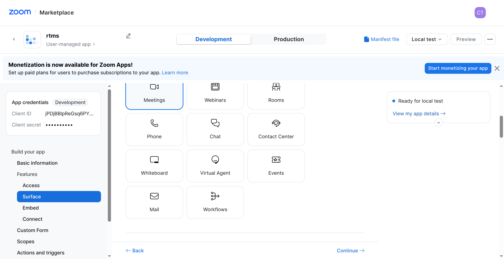

# 50 Start and approval

Takes the lifecycle webhooks safely, decides whether a stream may be opened, and starts RTMS on purpose. It opens no WebSockets. A verified, claimed stream is handed to the lifecycle client in `60-stream-lifecycle-client`.

## Run this folder alone

```bash
npm run demo:03        # offline: signed webhooks, dry-run REST, no credentials
npm run live:check     # settings check; reads .env when present, makes no changes
npm run live           # full service: webhook -> claim -> PATCH -> live client
```

`demo:03` prints the lifecycle decisions and exits. `live:check` prints `[ ok ]`, `[info]`, `[warn]` and `[FAIL]` rows, then exits nonzero only on a `FAIL`; it is safe with no environment. `live` starts on `PORT_03` (default 4803) and needs `ZOOM_SECRET_TOKEN`, `ZOOM_CLIENT_ID` and `ZOOM_CLIENT_SECRET` for real webhooks and client handshakes. `TENANT_ACCOUNT_IDS` gates which Zoom accounts are accepted; `ZOOM_REDIRECT_URI` or `ZOOM_ACCESS_TOKEN` is required only for REST-initiated start, stop, pause and resume. The detailed setup is in "Connect to real Zoom" below.

## Meeting SDK bot vs RTMS

| A Meeting SDK bot | RTMS |
|---|---|
| Your service decides when to join, and joins once. | Zoom decides when a stream exists and tells you with a webhook. Webhooks are retried, so the same event can arrive several times. |
| A second join is a second participant. | A second connection for the same stream kicks the first. Duplicates must be dropped before anything connects. |
| No approval step. | A start can be denied, delayed, or blocked by policy. `rtms.request_status` explains it. A started webhook may never come. |
| One service account. | Every stream belongs to a tenant with a consent reference. |

## The flow

```text
POST /webhook
  |  verify x-zm-signature on the RAW body, 300 s timestamp tolerance   -> 401 and trace webhook_rejected
  |  parse JSON                                                          -> 400
  |  endpoint.url_validation                                             -> 200 with the encrypted token
  |  dedupe: event + account + meeting + stream + event_ts, and x-zm-request-id
  |       already seen (kept 65 minutes)                                 -> 200 duplicate, first attempt wins
  v  200 accepted   <-- the HTTP answer is decided here, before any work
  |
  +-- *.rtms_started   tenant and consent gate -> capture filter (yours) -> meeting policy -> claim (tenant|product|meeting|stream)
  |       filtered out, or another user's stream is live -> stream_refused, onStreamDeclined (stop it by REST)
  |       claimed or superseded   -> onStreamReady(stream)   (generation, consent ref, policy version)
  |       hand-off throws         -> claim abandoned, stream_start_failed, alert
  |       same owner, still live  -> stream_refresh          (no second connection)
  |       held by another worker  -> duplicate_stream_dropped
  |       stream already finished -> late_duplicate_dropped
  +-- *.rtms_stopped   decideStop(reason) -> release the claim, purge flag for reason 8, alert if needed
  +-- *.rtms_interrupted   record it. The owner recovers it; nothing new is opened
  +-- rtms.request_status  decideRequestStatus: 7 pauses starts until the reboot time, 8 resumes, unknown alerts
  +-- rtms.concurrency_near_limit / _limited   shed noncritical starts near the limit, block at it.
  |       A stop at the limit drops to "near" (one slot is free, not many). Shedding expires after 5 minutes
  |       without a fresh near-limit event, because the sample cannot know the real count.
```

Only the first delivery of an RTMS event counts. Later retries of the same event are dropped by the natural key even if Zoom sends them with a new delivery ID. In practice the retry rarely matters for a started event: Zoom re-delivers about a minute later, but the signaling and media connections must be up within 60 seconds of the first delivery, so the retry usually lands after the stream is already live. The 65-minute key retention exists for the rare slow start, where it makes dedupe deterministic instead of lucky.

## Handing the stream to a worker

`onStreamReady(stream)` is where you start the stream-lifecycle client, or put a message on a queue. In `npm run live` it is [src/liveBridge.js](src/liveBridge.js): it opens the real session, moves a live stream to new server URLs when Zoom sends a fresh started webhook for it (`onStreamRefresh`), finalizes it on a stop webhook (`onStreamStopped`), and releases the claim when the session ends. Two calls keep the claim honest:

- If the hand-off throws, the service abandons the claim (no tombstone, since the stream never ran), records `stream_start_failed` and alerts, so a later webhook for the same stream can try again. Without this the heartbeat would keep a dead claim alive.
- When the client finishes for any reason, call `service.releaseStream(streamId, reason)`. It stops lease renewal and marks the stream finished, so a late duplicate started webhook cannot reopen it. A server stop webhook does the same.

## Two users, one meeting

Every user who has your app can start it, and each started webhook carries the starter's `operator_id`. The three deduplication layers remove repeats of **one** stream. They do not remove a second user's separate stream, so the service also decides at meeting level. Set `MEETING_POLICY`:

| Policy | What happens |
|---|---|
| `first_wins` (default) | The first stream opens. A different user's stream for the same tenant, product and meeting is declined while the first is live. |
| `keep_both` | Every stream opens. Each one uses a concurrent stream and credits. |

How it behaves:

- The same user starting again (a restart with a new stream ID) is not a rival, even if the old claim has not been released yet.
- Without an `operator_id` the service cannot tell users apart, so it does not refuse.
- The check and the claim run in one step with nothing awaited between them, so two webhooks for one meeting that arrive together cannot both pass.
- Once the first stream ends or is released, the next user's stream may start.
- A declined stream is traced as `stream_refused` with the reason `duplicate_meeting_stream`, the holding stream and its operator, and is passed to `onStreamDeclined`. The declined stream still exists on Zoom's side. In `npm run live` that hook stops it by REST with that user's own token (`STOP_DECLINED_STREAMS=false` only logs it).

"Owner wins" is not built in. Zoom's started webhook says whether the operator is the original host, so you can express it in a capture filter or change `findRival`.

## Should we process this meeting?

Auto-start works by category (meetings I own, internally hosted, externally hosted), not by meeting. A rule such as "only meetings on a customer calendar" cannot be expressed there, so accept the webhook, decide, and stop the stream. Point `CAPTURE_FILTER_MODULE` at a file with a default export:

```js
// my-filter.js
export default async function capture({ tenantId, meetingId, meetingNumericId, operatorId, originalHost }) {
  const expected = await myCalendar.hasEvent(tenantId, meetingId); // your own lookup
  return expected ? true : { capture: false, reason: 'not_on_calendar' };
}
```

- It returns `true`, `false` or `{ capture, reason }`, and may be async.
- It runs after the tenant gate and before any claim. A declined stream is handled like a duplicate: `stream_refused` with the reason `filtered_out` and your `filterReason`, then `onStreamDeclined`.
- It is not run again for a refresh webhook of a stream that is already live, so a live stream is never re-judged or stopped by it.
- A filter that throws does **not** drop the meeting. The stream is captured, `capture_filter_failed` is traced, and an alert is raised.
- Whether a stream that is stopped right after it started is billed differently is not documented. Measure it before you rely on this for cost control.

## Starting on purpose

`requestStart({ meetingId, participantUserId, accountId, policy })`:

1. Tenant and consent gate. A refused tenant never reaches Zoom.
2. Capacity gate: paused by a scheduled server update, shedding near the concurrency limit, or blocked at the limit.
3. Builds an **audit snapshot** and writes it with the attempt: meeting, target user, app client ID, the policy snapshot you passed, authorization result, tenant, consent reference, media requested, time.
4. `PATCH /live_meetings/{meetingId}/rtms_app/status` with `{ action: "start", settings: { client_id, participant_user_id? } }`, using that user's token. The outcome is classified: `204` accepted, `3000`/`4927` meeting not started, `13267` RTMS app disabled, `13262` app not authorized, `2308`/`2309` role, `2312` participant, `13273` unsupported, `13277` needs a started app, `404` not found (double-encode UUIDs that start with `/` or contain `//`), `429` back off. The first `204` is only "accepted".
5. Arms a **watchdog** (default 60 s). If the started webhook does not arrive, it records the audit order to follow (installation, attendee-side policy, invite list, host presence, host approval, host tools, `rtms.request_status`) and raises an alert. A matching started webhook or `rtms.request_status` cancels it.

With neither `ZOOM_REDIRECT_URI` (per-user tokens) nor `ZOOM_ACCESS_TOKEN` (one token) it runs in dry-run mode: the same flow, no network.

Stop, pause and resume use the same endpoint with `action: "stop"`, `"pause"` or `"resume"` (`requestStop`, `requestControl`). They are the building block for your own pause button where a client has none, for example a browser client. The stream state messages tell you when a pause or resume took effect.

## User authorization (OAuth)

RTMS acts on behalf of a Zoom user. A bot had one service identity. REST start, stop, pause and resume therefore need **that user's** access token, so the service keeps one token record per Zoom user ([src/oauth.js](src/oauth.js)).

```text
user -> GET /oauth/authorize ------------> Zoom asks the user to allow the app
Zoom -> GET /oauth/callback?code&state --> code exchanged, user identified, tokens stored
REST call for a user -> that user's token, refreshed shortly before it expires
user removes the app -> POST /oauth/deauthorize -> tokens deleted (you must delete the user's other data too)
```

What it does:

- **Refresh.** Access tokens last one hour. The service refreshes a minute early, shares one refresh between callers that arrive together, and stores the newest refresh token every time because Zoom rotates it. Refresh tokens last 90 days.
- **Reauthorization.** If a refresh is rejected, or the token lacks a scope listed in `OAUTH_REQUIRED_SCOPES`, the user is marked `reauthorization_required`. Calls for that user answer `reauthorization_required` at once, without a network call and without a retry. Scopes you add to the app later are not on tokens issued earlier, so existing users land here until they authorize again. A transient refresh failure (for example a 503) does not flag anyone.
- **401 from the API.** The call forces one refresh and retries once. A second 401 flags the user.
- **Identifying the user.** After the code exchange the service calls `GET /users/me`, which needs the `user:read:user` scope. If your app does not request it, pass the Zoom user ID yourself.
- **Deauthorization.** Set `POST /oauth/deauthorize` as the app's deauthorization URL. The request is verified like any webhook, and only a verified `app_deauthorized` for your client ID deletes tokens. Zoom requires you to delete all other data you hold for that user as well.
- **Reporting.** `GET /api/oauth/users` (admin token) lists each user's status, scopes and times, and a summary such as "authorized 38, reauthorization required 4". It never returns a token.

Set `ZOOM_REDIRECT_URI` to the public URL of `/oauth/callback` and use the same value in your Marketplace app. Tokens are secrets. The default file store (`OAUTH_TOKEN_DIR`) writes owner-only files and is for development. In production keep them in your secret store with the same `get`, `set`, `delete` and `list` contract, or set `OAUTH_STORE=memory` to hold them in memory only. Without `ZOOM_REDIRECT_URI` the server keeps the single `ZOOM_ACCESS_TOKEN` shortcut, or runs as a dry run.

Two authorization entry points both work, and they behave differently:

- `GET /oauth/authorize` on this server mints a single-use state and redirects to Zoom. The callback carries that state and is verified against the server's own record.
- The **Authorize button inside Marketplace** sends the user back with a code but **no state at all**, because the state is this server's own CSRF value. The callback accepts that too and exchanges the code directly (logged as `marketplace-initiated authorization`).

A bare `invalid_or_expired_state` failure with a code present means an old or foreign callback; the newer server versions fall back automatically, and the 400 page names the correct entry point. Scopes are granted at authorize time: a scope added to the app later appears on tokens only after the user authorizes again, and the refresh path flags the user `reauthorization_required` until they do.

## Connect to real Zoom

`npm run live` is this server with the lifecycle client attached: a verified, claimed `rtms_started` webhook opens real signaling and media sockets to Zoom's RTMS servers.

1. **Credentials.** `cp .env.example .env` and set `ZOOM_SECRET_TOKEN`, `ZOOM_CLIENT_ID` and `ZOOM_CLIENT_SECRET` from your Marketplace app. The client secret signs the handshakes. They stay in `.env`, which is ignored by git.
2. **Which account.** Set `TENANT_ACCOUNT_IDS` to your Zoom account ID. Not sure of it? Leave it empty, start a stream once, and copy `accountId` from the `stream_refused` line the server logs, then set it and restart. This is the tenant and consent gate at work: an account you have not listed never gets a connection.
3. **What to receive.** `RTMS_MEDIA` (default `audio,transcript`). For video choose `RTMS_VIDEO_MODE=activeSpeaker` or `individual`. See `.env.example` at the sample root for formats, reconnect windows and output.
4. **Check the setup.** `npm run live:check` verifies the settings without printing them. After you expose the server, `npm run live:check -- --public-url https://<your-host>/webhook` sends Zoom's URL-validation challenge to that public URL, so you know the path reaches this server and the secret matches.
5. **Expose the webhook.** Zoom must reach `POST <WEBHOOK_PATH>` on `PORT_03` over HTTPS. Put a reverse proxy or tunnel in front, and keep `HOST=127.0.0.1` so the server itself is not public. Set the same URL as your app's development webhook URL in Marketplace, subscribed to the six meeting RTMS events (`meeting.rtms_started`, `meeting.rtms_stopped`, `meeting.rtms_interrupted`, `rtms.request_status`, `rtms.concurrency_near_limit`, `rtms.concurrency_limited`), and wait for the green validation tick - a saved-but-unvalidated URL receives nothing.
6. **Run it.** `npm run live`, then start a meeting with RTMS enabled for your app (the account admin must have enabled RTMS for it first, and the app's Meetings surface must be enabled in Marketplace), or use `/api/start`. The verified sequence end to end: user authorizes (tokens stored), a live meeting with the user present, `PATCH .../rtms_app/status` returns 204, `rtms_started` arrives within seconds, sockets connect, and `phase streaming` follows.

What the log shows, one JSON line each: `listening for Zoom webhooks`, then on a stream `connecting to the RTMS signaling server`, `phase signaling_connected`, `media_connected`, `client_ready_sent`, `streaming`, a `stats` line every 10 seconds, `participant join`, and at the end `stream finished` with the stop reason and the path of `manifest.json`. `GET /api/state` shows live streams and socket states. Ctrl-C closes every live stream with `STREAM_CLOSE_REQ` before exiting.

Transcript text is content, so it is not logged by default. `RTMS_PRINT_TRANSCRIPT=true` prints it and `RTMS_SAVE_TRANSCRIPT=true` appends it to `transcript.jsonl` next to the manifest. The same applies to anything else you add to `onPacket`.

If a stream does not appear, work down this list - each item below was observed live:

- **The meeting already ended.** A start request for a dead meeting stays pending, blocks retries for that meeting with `already_pending`, and its watchdog fires with no webhook ever coming. Clear it by restarting the service (pending starts are in-memory) and start against a live meeting ID.
- **`started_webhook_missing` alert.** The PATCH was accepted (or dry-run) but no started webhook arrived. Causes seen in practice: dry-run mode with no token, the meeting ended before the webhook, the account is not in `TENANT_ACCOUNT_IDS`, or the webhook secret went stale after a rotation so Zoom's probes bounce with 401.
- **Immediate restart race.** A stop and immediate restart are two accepted requests, not one atomic handoff. The replacement `started` webhook can be missed while the prior generation finishes; the watchdog can then fire with no matching `rtms.request_status`. A later bounded retry can succeed with a new stream ID. Treat one missed webhook after an immediate restart as a retryable race, not proof that the meeting is dead.
- **Meeting ID form.** Use the numeric meeting ID in the live-meeting status path. The URL-encoded meeting-UUID form returned Zoom code `300`, `Invalid meeting id`, on a lifecycle stop; retrying with the numeric ID was accepted.
- **Surface disabled.** The Marketplace app's Meetings surface checkbox must be on, or Zoom accepts every start and emits nothing.
- **Webhook endpoint changed.** A webhook URL edit is not transparent: in development the authorization URL must be regenerated and the app added again, and in production the app must be resubmitted for approval. A missed step here silences every event, not only `rtms_started`.
- **Delivery evidence.** The Marketplace dashboard logs successful and failed webhook deliveries. Check it before assuming a webhook was never sent: a delivered-but-unhandled event is our bug, an undelivered one is configuration.
- **Credentials for the media path.** A fired webhook is not success: the signaling and media handshakes still need correct client credentials, and a wrong secret fails there, after the webhook. The 60-second windows make this look like a missing stream, not an auth error.

- **Validation green but silent.** Re-run URL validation from the marketplace UI after any secret or deployment change, and watch your access log for the `Zoom Marketplace/1.0a` user agent - your own signed probes returning 200 do not prove Zoom's side.

The 60 second watchdog logs the audit order (installation, attendee-side policy, invite list, host presence, host approval, host tools) when a REST start produced no started webhook.

## Simulated demo

`npm run demo:03` replays a fixed script of signed webhooks into the service in-process, with a throwaway secret and no network, so you can read each decision without a meeting. It is a simulation of Zoom's webhooks, not a connection to anything. `-- --write-trace` also appends the events to the shared trace for the reporting dashboard.

## Run it

```bash
npm run live:check                   # verify your .env, optionally the public webhook URL
npm run live                         # real Zoom: POST /webhook, /api/start|stop|pause|resume, GET /api/state, /healthz, /oauth/*
npm run demo:03                      # the simulated walkthrough
```

The server binds to `127.0.0.1`. The operator API takes an optional bearer token (`ADMIN_API_TOKEN`). Tenants load from `TENANTS_FILE`, `TENANT_ACCOUNT_IDS`, or [tenants.sample.json](tenants.sample.json).

## Swap points for production

| In the sample | In production |
|---|---|
| Dedupe set and claim registry live in memory, per process | One shared store: an atomic unique-key insert in your database, or Redis `SET key owner NX PX`, so every instance sees the same claims. Without it, two instances can both open the same stream. |
| Lease renewed by `heartbeat()` every `CLAIM_LEASE_MS / 3` | Same contract. A fenced worker (claim taken over) stops using the stream. |
| Trace file | Your logging or event pipeline |
| `tenants.sample.json` | Your install and consent records |
| Work runs after the 200 in the same process | Put the verified event on a queue and return 200 first |
| `onStreamReady` starts the client in-process | Enqueue a message for a worker, and call `releaseStream()` when that worker reports the stream finished |

## Adapting this sample

The sample is a working service, so start from the swap table above and then touch the seams it names.

- **Who may stream.** The tenant and consent gate lives in [src/service.js](src/service.js) (the verdict that decides whether a stream may open, plus capacity and the claim). Replace the sample lookup with your install and consent records; keep the same verdict contract.
- **Where the stream goes.** `onStreamReady` in `src/liveBridge.js` is the hand-off point. Put your worker queue there, and call `releaseStream()` when your worker finishes.
- **Your tenants.** Copy `tenants.sample.json` to `tenants.json` and fill in your accounts, policies and consent references; the shape is the contract.
- **OAuth surface.** [src/oauth.js](src/oauth.js) stores per-user tokens in a file. Swap the store for your database; the token lifecycle (refresh, rotation, reauthorization, deauthorization) is already handled and tested.
- **Persistence.** The dedupe set and claim registry are in-memory. Before two instances can run, move them to a shared store as the swap table describes.

## Files and tests

`server.js` (the live server), `check.js`, `demo.js` (simulated), `src/service.js`, `src/liveBridge.js`, `src/restClient.js`, `src/oauth.js` (per-user tokens), `src/probes.js` (the webhook URL check behind `live:check`), `tenants.sample.json`, `service.test.js` (30 tests, including meeting policy, the capture filter, pause and resume and per-user REST tokens: rejected webhooks, retries, refresh, two workers, lease takeover and fencing, failed hand-off, release, stop idempotency, revoked purge, request status, concurrency, REST outcomes, watchdog cancellation, audit snapshot), `liveBridge.test.js` (8 tests, no RTMS server involved: a stop webhook ends a session and writes the manifest, retries never open a second session, refresh handling, bad credentials abandon the claim, refused accounts never open a session, shutdown, live config). `oauth.test.js` (11 tests: state, code exchange, refresh and rotation, reauthorization, deauthorization, file store), `probes.test.js` (1 test: the URL validation check against a local endpoint). What a live session does against Zoom is checked by running `npm run live`.

---

## Step 5. Take the webhook safely and start a stream

A bot joined once. RTMS webhooks are retried, and a retry can open a second connection that kicks the first. So the endpoint has a strict order of operations.

### What the started webhook contains

The event name depends on the product: `meeting.rtms_started`, `webinar.rtms_started` or `session.rtms_started` (Video SDK). Contact Center voice has its own started event, and the code here accepts it too. Persist the whole object. For a meeting expect the account ID, the meeting ID and UUID, the operator ID, `rtms_stream_id`, `server_urls`, and an indicator for whether the operator is the original host. Video SDK uses a session ID and key instead of a meeting UUID.

The stream ID plus your signed credentials authorize the signaling handshake, and `server_urls` says where to connect. Treat the raw object as the recovery record and do not rebuild it from the meeting APIs later. `shared/rtmsPayload.js` reads these fields into one shape and keeps the raw object next to it.

### The flow

The full diagram is in **The flow** above. The contract in words: verify the signature on the raw body, parse, answer URL validation, deduplicate, return 200 before any work, and only then act on the event.

### Three layers of deduplication

| Layer | Key | Rule |
|---|---|---|
| Webhook | event + account + meeting or session + `rtms_stream_id` + `event_ts`, plus `x-zm-request-id` | Only the **first** delivery counts. Later retries are dropped. Keep the keys at least 65 minutes, because Zoom retries for up to an hour |
| Connection | tenant + product + meeting + `rtms_stream_id` | One claim, one owner. A lease that is not renewed expires, so a crashed worker cannot hold a stream forever. A takeover bumps a generation number (a fencing token) and the old owner can no longer renew or release. A finished stream cannot be reclaimed |
| Artifact | `chunk_id = sha256(tenant + meeting + stream + media type + timestamp + bytes)`, `final_id = tenant + meeting + artifact type + generation` | Reprocessing the same bytes never makes a second chunk. Never deduplicate by meeting UUID alone |

On top of the three layers sits a meeting-level rule, because the three remove repeats of **one** stream but not a second user's separate stream for the same meeting. `MEETING_POLICY=first_wins` (default) declines a different user's stream while the first is live; `keep_both` opens every stream. A rule that auto-start cannot express (for example "only meetings on a customer calendar") belongs in a capture filter: accept the webhook, decide, and stop the stream by REST. Both are in the start-and-approval sample (50-start-and-approval/readme.md) and covered by tests.

### Rules to hold

- Never connect because a control state looked favorable. Connect only after the verified, deduplicated, claimed started webhook.
- A pause is recoverable. A stop is terminal for that `rtms_stream_id`.
- Treat `request_status`, started, interrupted, stopped, stream state and session state as separate evidence, and reconcile them by IDs and timestamps.
- Persist the raw payload before you transform it, so a new field or status can be replayed. (The samples keep it in memory only. You should write it to durable storage.)
- If the hand-off to a worker fails, give the claim back so a later webhook can try again. When a worker finishes, release the claim so a late duplicate cannot reopen the stream.

### Starting on purpose, and the missing webhook

The mechanics are in **Starting on purpose** above: the gates, the audit snapshot, the outcome classification and the watchdog. Two things the guide adds. The call acts for one Zoom user, so it needs **that user's** access token, not a service credential; keep one record per user, refresh before expiry, store the newest refresh token, and mark a user who must authorize again instead of retrying. And you cannot recover a missing lifecycle webhook by polling: do not connect from a stale webhook, and treat repeated misses as a degraded lifecycle.

**What happens at the concurrency events?** Treat `rtms.concurrency_near_limit` as a capacity action: shed or defer noncritical starts, warn tenant admins, protect active meetings. Treat `rtms.concurrency_limited` as a hard stop for new streams. Retry only after capacity frees, with jitter, and do not open speculative connections for every media type. Record the number, the limit, the tenant and the time. If limits are hit often, contact Zoom support or your Zoom sales representative to raise the account's concurrency limit so the shedding never becomes routine.

### Connecting to Zoom, what the log shows

The setup steps are in **Connect to real Zoom** above. Once live, the log shows, one JSON line each: `listening for Zoom webhooks`, then for a stream `connecting to the RTMS signaling server`, `phase signaling_connected`, `media_connected`, `client_ready_sent`, `streaming`, a `stats` line every 10 seconds, `participant join`, and at the end `stream finished` with the stop reason and the path to `manifest.json`. `GET /api/state` shows live streams and socket states. Ctrl-C closes every live stream with a close request before exiting.

`npm run demo:03` replays a fixed script of signed webhooks through the same service, in-process, with a throwaway secret and no network. It is a simulation, useful for reading each decision without a meeting.

---
