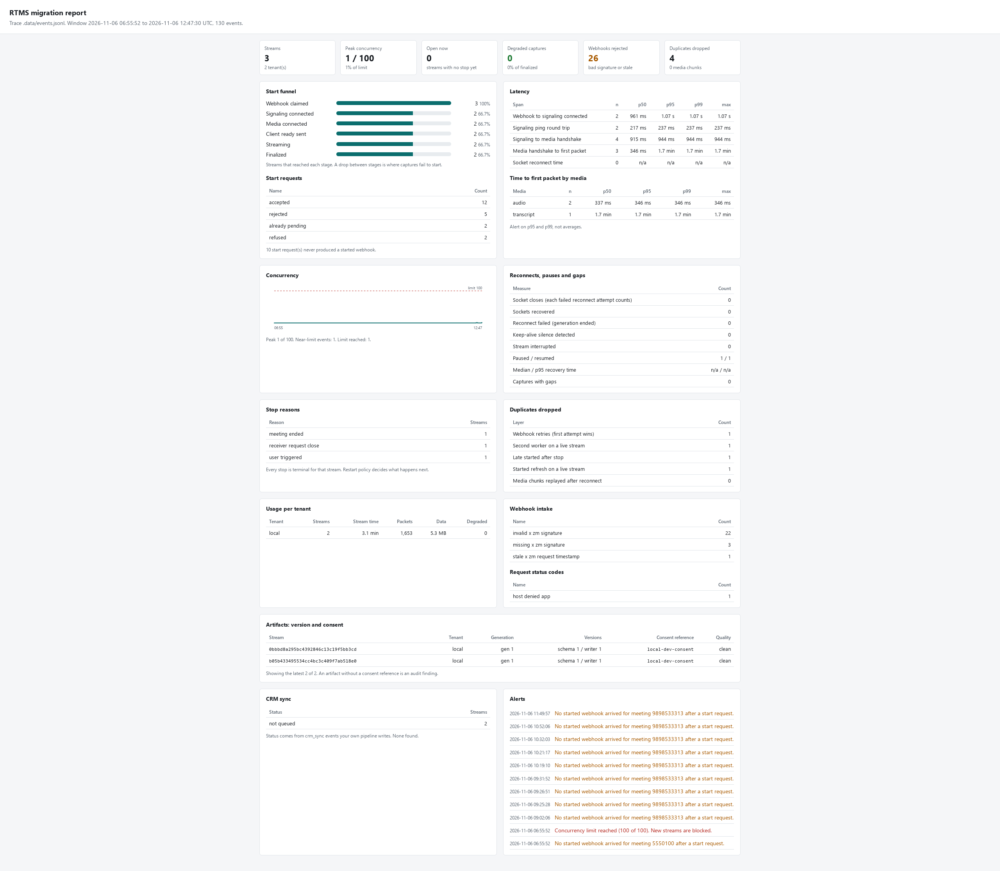

# 70 Reporting dashboard (Step 7: operate it)

Reads the JSON-lines event trace written by steps 5 and 6 and renders the operational metrics you need after launch: start funnel conversion, per-hop latency (p50/p95/p99), peak concurrency against your entitlement limit, socket recovery rates, stop reasons, per-tenant usage, consent coverage, CRM sync status, and critical alerts.

**Contents**

- [Run this folder alone](#run-this-folder-alone)
- [How operations differ from a bot](#how-operations-differ-from-a-bot)
- [Dashboard panels and CRM sync events](#dashboard-panels-and-crm-sync-events)
- [Multi-tenant isolation](#multi-tenant-isolation)
- [Production checklist and swap points](#production-checklist-and-swap-points)
- [Customer rollout, cost, and concurrency](#customer-rollout-cost-and-concurrency)
- [Zoom support and protocol notes](#zoom-support-and-protocol-notes)
- [Pre-launch gate](#pre-launch-gate)
- [Adapting this sample](#adapting-this-sample)
- [Files and tests](#files-and-tests)

## Run this folder alone

```bash
npm run demo:70 -- --json        # offline: prints seeded report summary as JSON
npm run demo:70                  # offline: writes .data/report.html and prints text summary
npm run start:70 -- --sample     # serves seeded dashboard at http://127.0.0.1:4806/
npm run start:70                 # serves your live trace (TRACE_FILE, default .data/events.jsonl)
node 70-reporting-dashboard/cli.js --trace .data/events.jsonl --hours 24 --out report.html
```

No environment variables are needed for `--sample`. `npm run live` and `npm run demo:03 -- --write-trace` write directly to `.data/events.jsonl`. The dashboard outputs one self-contained static HTML page with no scripts or external assets and all trace values HTML-escaped. `GET /api/report` returns the same report as JSON.



[sample-data/generate.js](sample-data/generate.js) builds a deterministic sample trace (24 streams across 3 tenants, including reconnects, pauses, duplicates, rejected webhooks, a watchdog firing, a concurrency limit hit, CRM statuses, and one missing `consent_ref` audit finding). [sample-data/events.sample.jsonl](sample-data/events.sample.jsonl) commits a 6-stream snapshot tested against the generator.

## How operations differ from a bot

| Meeting SDK bot | RTMS |
|---|---|
| One join metric dominated | Four hops fail independently: Zoom to webhook, webhook to signaling, handshake to first packet, packet to output |
| Averages hid little | Alert on p95 and p99; means hide slow starts |
| Capacity scaled with your servers | Concurrency is an account entitlement counted per media socket; track peak utilization before `rtms.concurrency_limited` blocks starts |
| Usage measured bot minutes | Meter per tenant and per media socket |
| Retention was mostly storage cost | Every artifact needs a `consent_ref`, schema version, and purge path for stop reason 8 |

## Dashboard panels and CRM sync events

Percentiles use nearest-rank calculation.

| Panel | Source trace events |
|---|---|
| Start funnel and REST start attempts | `stream_claimed`, `stream_phase`, `start_attempt`, `request_status`, `start_watchdog_fired` |
| Latency p50/p95/p99 per span and first packet by media | `latency_span` |
| Concurrency over time vs limit | Stream start/end intervals, `concurrency` |
| Reconnects, pauses, and gaps | `socket_closed`, `socket_recovered`, `reconnect_failed`, `keepalive_silence`, `stream_state`, `stream_finalized` |
| Stop reasons (one per stream) | `stream_stopped`, `stream_finalized` |
| Duplicates dropped by layer | `webhook_duplicate`, `duplicate_stream_dropped`, `late_duplicate_dropped`, `stream_refresh`, `stream_finalized` |
| Usage per tenant | `stream_finalized` |
| Artifacts (version, generation, consent reference) | `stream_finalized` |
| Webhook intake (rejected and gate-refused) | `webhook_rejected`, `stream_refused` |
| CRM sync status | `crm_sync` |
| Alerts | Revoked stream, missing `consent_ref`, concurrency limit reached, fenced claim, missing started webhook |

### Appending `crm_sync` events

Your downstream pipeline writes one `crm_sync` line per status change:

```json
{ "v": 1, "type": "crm_sync", "streamId": "rtms-1004", "tenantId": "acme", "status": "pending" }
{ "v": 1, "type": "crm_sync", "streamId": "rtms-1004", "tenantId": "acme", "status": "failed", "attempts": 3 }
```

The latest status per `streamId` wins. Finalized streams without a `crm_sync` event appear under `not queued`.

For production alerting, watch p95/p99 first-packet latency, reconnect failures, `start_watchdog_fired`, `rtms.request_status` errors, `rtms.concurrency_near_limit`, missing `consent_ref` findings, and stop reason `8` (`stream_revoked`).

## Multi-tenant isolation

Store five records per tenant:

- App installation and authorized users
- Admin policy snapshot
- Approved host domains or meeting IDs required for audit
- Consent references
- Stream and media mappings with retention class

Gate every stream start and artifact write on an active tenant permitting that product, media list, and consent reference. Enforce tenant-scoped storage paths and reject path traversal (`shared/tenantGate.js`).

## Production checklist and swap points

### Production checklist

| # | Requirement | Included in these samples | You own in production |
|---|---|---|---|
| 1 | Verify, persist, and queue webhooks before side effects | Raw-body signature check, 300 s window, HTTP 200 before dispatch | Durable raw-body archive and queue between ingress and workers |
| 2 | Event, connection, and artifact idempotency | Three dedupe layers with lease fencing | Shared claim store (DB/Redis) across multiple replicas |
| 3 | Answer keep-alives on every socket | Keep-alive replies plus 65 s silence watchdog | Event-loop health monitoring under load |
| 4 | Independent socket reconnect with bounded jittered backoff | Per-socket timers, jitter, attempt cap, reconnect windows | Network tuning and consumer backpressure |
| 5 | Preserve recovery markers, pause boundaries, and gaps | Segments, gaps, `degraded` flag, versioned manifest | Writing boundaries and gaps into your artifact format |
| 6 | Normalize joins, renames, duplicate names, and roles | Stream-scoped participant registry | External role source and cross-system identity resolution |
| 7 | Isolate tenants, credentials, policy, and retention | Tenant gate, sanitized tenant paths, audit snapshot, revoke reconciler | Per-tenant secret isolation, retention jobs, full deletion on revoke |
| 8 | Log IDs and state, never secrets or raw media | Trace emits IDs and state names only | Log redaction and access control |
| 9 | Test host absence, denial, cohost change, waiting room, lock, webinar, pause, resume, revoke | Request status, pause/resume, and revoke handlers | Live tests on real Zoom accounts for cohost, waiting room, lock, and webinars |
| 10 | Load-test concurrent streams and socket recovery | Not covered | Real load and chaos tests against Zoom under your entitlement |
| 11 | Enforce TLS 1.2 or 1.3 (required since 2026-11-15) | Node + `ws` negotiate TLS 1.2+ by default | Proxy, CDN, and runtime TLS configuration |
| 12 | Per-user OAuth, reauthorization, and deauthorization | [oauth.js](../50-start-and-approval/src/oauth.js) lifecycle and signed deauthorization | Secret store for tokens, full user-data deletion, reauth outreach |
| 13 | Count concurrency per media socket and absorb top-of-hour spikes | Near-limit shedding and hard-limit blocking | Queueing, autoscaling workers, spike load testing |

### Pre-production swaps

| In the samples | In production |
|---|---|
| In-memory dedupe set and claim registry | Shared DB unique-key insert or Redis `SET key owner NX PX leaseMs` keeping fencing generations |
| JSON-lines trace file (no database) | Structured logging or analytics store preserving the same event names |
| [tenants.sample.json](../50-start-and-approval/tenants.sample.json) or `TENANT_ACCOUNT_IDS` | Your tenant install, policy, and consent records |
| File token store (`OAUTH_TOKEN_DIR`) | Secret manager or encrypted database column with `get`/`set`/`delete`/`list` |
| In-process dispatch after HTTP 200 | Durable queue between stateless webhook ingress and stream workers |
| `onPacket` callback | Durable, versioned, tenant-scoped artifact writer |
| Static HTML dashboard | Your production metrics and paging stack |

## Customer rollout, cost, and concurrency

### Staged rollout

Moving customers takes longer than shipping code:

1. **Build and review:** submit a separate user-managed RTMS app early.
2. **Dogfood:** run on your own account plus one external test tenant.
3. **Design partners:** onboard 3-5 customers with admin assistance, running RTMS and the bot side by side behind a per-tenant flag.
4. **Cohorts:** run a reauthorization campaign with an admin setup kit, enabling RTMS per tenant.
5. **Default to RTMS:** restrict the bot to explicit exceptions with a sunset date.
6. **Decommission:** shut down the bot fleet.

While both run, never let RTMS and a bot capture the same meeting unless the bot triggers strictly as a fallback when no `rtms_started` arrives by a set deadline. Track start success rate, first-packet latency, capture share vs your bot baseline, approval prompt and denial rates, reauthorization completion, and cost per captured hour.

### Cost and concurrency accounting

1. **Entitlements:** RTMS requires Zoom Developer Pack credits (volume pricing above 500 credits goes through Zoom sales). Basic accounts are unsupported; webhooks do not fire and REST calls fail with `2310`.
2. **Concurrency limits:** default limit is 2,000 concurrent streams on a Developer Pack (5 on free trial); higher limits are granted by request.
3. **Count per media socket:** a concurrent stream is one RTMS session ID per media socket, not per meeting. Audio plus video on separate sockets counts as two sessions. Size capacity as live meetings multiplied by open media types.
4. **Limit events:** `rtms.concurrency_near_limit` fires above 80% utilization; `rtms.concurrency_limited` fires at 100%. `rtms.request_status` code `5` means no limit is configured on the account.
5. **Check sub-accounts early:** verify concurrency limits on every account and sub-account before launch; partners have encountered unconfigured sub-account limits.
6. **REST start rate limits:** Zoom's RTMS guide cites 80 requests/second per account (shared across light APIs), while the API reference lists a MEDIUM rate-limit label. Check Zoom's current rate-limit table and rely on `retryingRestClient.js` for `429` backoff.

To compare costs against bots: multiply meetings per day x average duration x open media sockets x multi-user duplicate factor, then add transfer, decode, storage, and AI costs. Open only needed media types, use Zoom's transcript when it meets accuracy goals, and enforce `MEETING_POLICY=first_wins` plus capture filters.

## Zoom support and protocol notes

### What to attach to a Zoom support ticket

Gather these before contacting the Developer Forum or Premier Developer Support (Zoom engineering looks up streams internally using these IDs):

- Client ID and account ID
- Meeting UUID, numeric meeting ID, `rtms_stream_id`, and `operator_id`
- UTC timestamps plus raw payloads of `rtms_started`, `rtms.request_status`, and `rtms_stopped`
- Start path, REST error codes (`2308`, `2310`, `13262`, `13267`, `13273`), and `x-zm-trackingid` / `x-zm-request-id` headers
- User auto-start settings and host Always ask / Always allow state at that moment

### Shipped V2 protocol notes and caveats

- These samples send `protocol_version: 2`, use `event_code` instead of `event_type`, enforce 640x360 SD video, reject removed PNG video/share codecs, and support `phone.call_rtms_*` event matching. Zoom Phone audio and transcript also run on V2 in [library/javascript/rtmsManager](../../library/javascript/rtmsManager/RTMSManager.js).
- Transcript revisions (`attribute: 2` with matching `sentence_id`) replace prior sentences in [60-stream-lifecycle-client/src/transcriptStore.js](../60-stream-lifecycle-client/src/transcriptStore.js) when `RTMS_SAVE_TRANSCRIPT=true`.
- TLS 1.2 or 1.3 has been mandatory on all RTMS connections since 2026-11-15.
- Two documented Zoom caveats: closing an in-meeting app from the app menu fires no callback and can leave an orphaned stream (rely on idle/silence watchdogs), and switching to phone audio while computer audio remains connected stops transcripts until the user hangs up or leaves computer audio.

## Pre-launch gate

1. Run `npm run live:check -- --public-url https://<your-host>/webhook` against production.
2. Deliver step 4's admin and host instructions to customers before enabling them.
3. Subscribe to and alert on `rtms.request_status`, `rtms.concurrency_near_limit`, and `rtms.concurrency_limited`.
4. Rehearse a stop-reason-8 (`stream_revoked`) purge end to end: verify `artifactLifecycle.js` deletes files, logs `artifact_purge_completed`, and raises the dashboard alert.
5. Run a real meeting through `npm run live` and verify startup phases, a socket reconnect, and clean finalization.

## Adapting this sample

- **Add panels:** add reductions in [src/report.js](src/report.js) (pure function over trace events), render HTML/text in [src/render.js](src/render.js), and add a unit test.
- **Wire paging:** poll `GET /api/report` or forward critical trace events (`stream_stopped` with `purge: true`, missing `consentRef`, `concurrency_limited`, `claim_fenced`, `start_watchdog_fired`) to your pager.
- **Integrate CRM tracking:** append `crm_sync` events from your pipeline; any status string works.
- **Preserve the event contract:** keep event names and field shapes intact across steps 5, 6, and 7. [report.test.js](report.test.js) fails if the dashboard reads an event name that no writer emits.

## Files and tests

- Source: [cli.js](cli.js), [server.js](server.js), [src/report.js](src/report.js), [src/render.js](src/render.js), [src/artifactLifecycle.js](src/artifactLifecycle.js), [sample-data/](sample-data).
- Tests (`npm run test:70`, 9 tests): [report.test.js](report.test.js) (including contract verification that every event type read by the dashboard is emitted by a real source file).

---

## Elsewhere in the guide

Start from the [overview](../readme.md).

- [00 Design](../00-design/readme.md) - Production architecture, failover drills, media choices, observability, webhook SLO
- [10 Integration Advisor](../10-integration-advisor/readme.md) - Step 1: what changes, starter samples, gap checker
- [20 Configure](../20-configure/readme.md) - Step 2: Marketplace manifest, scopes, events, credentials
- [30 Publish](../30-publish/readme.md) - Step 3: review package, checks, common rejections
- [40 Prepare](../40-prepare/readme.md) - Step 4: admin enablement, host approval, consent, status codes
- [50 Start and Approval](../50-start-and-approval/readme.md) - Step 5: webhook intake, claims, tenant gate, OAuth
- [60 Stream Lifecycle Client](../60-stream-lifecycle-client/readme.md) - Step 6: signaling, media, keep-alives, reconnect, manifests
- [61 Media and Participants](../61-media-and-participants/readme.md) - Step 6: participant registry, camera selector, media profiles
